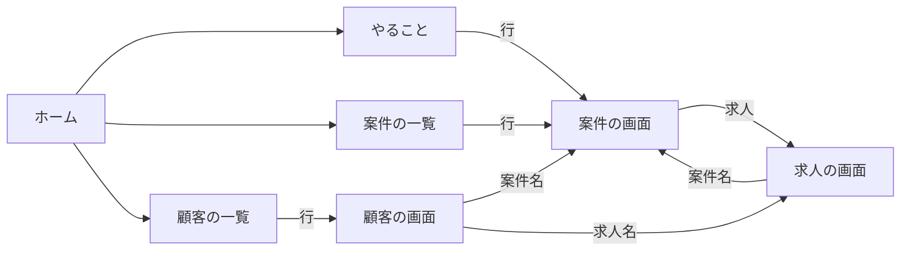

# 案件管理の画面構成の整理案（入口をまとめる・コンサルKPI を寄せる土台）

更新日: 2026-10-16
状態: 案（ユーザー確認待ち）

## 0. 決まっていること

- 案件管理（`/app/job-copy`）で、いちばん良い使い勝手を先に作る。できたら、コンサルKPI（`/consulting`）を案件管理に寄せる。今のコンサルKPI の画面は手本にしない（2026-10-16 ユーザー）。
- 常に見るものは大きく手元に置く。必要なときだけ使うものは畳む。
- 案件の正本は HubSpot。書き込みは CRM の仕組み（`PATCH /api/crm/deals/{id}`）を共用する。

## 1. いま散らばっているもの（棚卸しの結果）

| 困りごと | いまの場所 |
|---|---|
| 再読み込みが 5 か所ある | 画面上部（読み込み失敗時）・ホーム・案件の表・契約・成果の欄・求人一覧の再読み込み |
| 「データ取込」の中身がばらばら | 上部右の 1 ボタンの中に、HubSpot 読み取り・媒体の取込・課金 CSV・外部文面の照合が混在 |
| 外部文面の照合の入口が 2 つ | データ取込の中と、本文が無いときの空の画面 |
| 求人の分析が深い | 求人を選ぶ → 下へスクロール →「ほかの分析」→ 横から開く画面のタブ（13 機能） |
| 職種の一括指定が見つからない | ホームの「職種」カードを開いた中にだけある別画面 |
| デモと実データの切り替えが分かりにくい | サイドバーの最上部と URL |
| 担当者・やること・満了は、コンサルKPI にしかない（または、どこにもない） | コンサルKPI の「今日」「案件一覧」「満了と継続」。CSアクション予定日の一覧はどこにもない（#241 で案件管理に追加） |
| コンサルKPI と案件管理を行き来できない | リンクが無い |

## 2. 整理後の形

### 2-1. 上の段（全画面で共通、常に見える）

```
┌────────────────────────────────────────────────────────────────────────────┐
│ 案件管理  [ホーム] [やること 293] [案件] [顧客] [求人]      担当: コンサル担当 ▾ 自分 ▾  ⟳ 14:05  [ツール ▾] │
└────────────────────────────────────────────────────────────────────────────┘
```

- **画面の切り替え（5 つ）**：
  - ホーム：今日の全体。やることの件数と、まず見るもののカード。
  - やること：期限切れ・今日・7日以内・契約満了が近い（CSアクション予定日と契約満了日）。件数を常に出す。
  - 案件：納品管理の案件の一覧。コンサルKPI の「案件一覧」「担当者ごとの案件」をここに作り直す。
  - 顧客：顧客の一覧から顧客の画面へ。
  - 求人：求人の一覧（今のサイドバー）から求人の画面へ。
- **担当者で絞る**：全画面で効く 1 か所に置く。既定はコンサル担当 × 自分。
- **再読み込み**：1 つにまとめる。いつの値かを横に出す。押すと、その画面で使っている値を全部読み直す。
- **ツール（必要なときだけ）**：
  - データ取込（HubSpot 読み取り・媒体の取込・課金 CSV）
  - 外部文面の照合
  - 職種をまとめて指定
  - 表示するデータ（実データ／固定一覧／操作デモ）

### 2-2. 画面の行き来



- どの一覧の行からも、案件・顧客・求人の画面へ 1 回で行ける。ブラウザの戻るで戻れる（#232）。

### 2-3. 案件の画面

```
┌ 案件名  ステージ [求人出稿完了 ▾]   コンサル担当 ○○   満了 2027/09/30（あと 349 日）   [HubSpot で見る] ┐
│ ┌ 次にやること ────────────────┐  ┌ 契約 ───────────────┐  ┌ 成果 ────────────┐ │
│ │ CSアクション予定日 10/20     │  │ プラン・種別・開始・満了 │  │ 応募 25 面接 10      │ │
│ │ 内容 定例MTG①  [変更]        │  │ 金額 ¥360,000  [編集]   │  │ 内定 3 採用 2 [編集] │ │
│ └──────────────────────┘  └─────────────────┘  └────────────────┘ │
│ 求人（掲載中 3 ／ 過去 23）  週ごとの応募  出来事                                             │
│ 接触の記録（MTG・電話・担当交代）  ← コンサルKPI の「案件の詳細」を移す                     │
└──────────────────────────────────────────────────────────────────────────┘
```

- 一番上の 1 行に、いつも見るもの（ステージ・担当・満了までの日数）を置き、その場で変えられるようにする。
- 次にやること（CSアクション予定日・内容）を、契約・成果の隣に置く。終わったら次の予定に変える。

### 2-4. 求人の画面

```
┌ 求人名  媒体  掲載中  案件名 ┐
│ [概要] [本文・画像] [応募] [応募者] [課金] [市場] [変更差分] [比べる] [報告] │  ← 「ほかの分析」をタブにして上に出す
│ （選んだタブの中身）                                                     │
└────────────────────────────────────────────┘
```

- 「ほかの分析」の 13 機能を、求人の画面の上にタブで並べる。似ているものはまとめて 9 つにする。
  - タイムラインとライフラインは「概要」にまとめる。
  - 市場グラフ・市場データ・要因・仮説は「市場」にまとめる。
  - A/B 比較と全文比較は「比べる」にまとめる。
- 横から開く画面（ドロワー）は、出来事ごとの「応募者・課金・市場」を見るときにだけ使う。

## 3. コンサルKPI を寄せる順番

| 段 | 案件管理に作るもの | コンサルKPI の元の画面 | 状態 |
|---|---|---|---|
| 1 | 担当者で絞る・やること（CSアクション予定日・満了 30 日以内） | 今日（一部） | #241 |
| 1 | 契約・成果の編集、ステージ変更 | （コンサルKPI には無い） | #239・#242 済み |
| 2 | 上の段の切り替え・ツール・再読み込み 1 つ（この案の 2-1） | — | この案の確認後 |
| 3 | 案件の一覧（並べ替え・絞り込み：満了まで・最後の接触・成果・金額・ステージ） | 案件一覧・担当者ごとの案件 | |
| 4 | 案件の画面の上段（2-3）と、接触の記録（MTG・電話・担当交代） | 案件の詳細 | 接触の記録は今シートにしかないため、読み方を決める |
| 5 | 満了と継続（今月・来月・再来月の満了と、ステージ別の件数） | 満了と継続 | |
| 6 | 月の振り返り（継続率・成果と継続・記録の信頼度・チーム） | 成果と継続・記録と数字の信頼度・チームと担当 | 最後。移し終えたら `/consulting` をナビから外す（`hidden`） |

### 決めておくこと（段 3 までに）

- **担当者の正本**：コンサルKPI は「CS_担当履歴」シートの最新の担当、案件管理は HubSpot の `consultant` を使う。案件管理に寄せるなら HubSpot の `consultant` を正にする。担当交代の履歴だけはシートから読むか、HubSpot の項目の変更履歴から作る。
- **数字の鮮度**：コンサルKPI は前日のシートの値、案件管理は HubSpot の今の値。寄せた後は、今の値に揃える。継続率など集計の定義は、コンサルKPI の定義（`cs_dashboard/mod.rs` 冒頭）を引き継ぐ。
- **対象のパイプライン**：コンサルKPI はリクロジ_納品管理だけ、案件管理は請負契約_納品管理も含む。画面では両方を出し、パイプラインで絞れるようにする。

## 4. 現行を保つ利点 / 変える利点

- **現行を保つ利点**：画面の作り直しが要らない。コンサルKPI は日次で確定した数字なので、日中に数字が動かない。
- **変える利点**：案件の仕事が 1 か所で済み、その場で HubSpot を直せる。担当者・やること・満了が全画面で同じ定義になる。入口が 1 本になり、迷わない。
- **戻すコスト**：段ごとに出すので、各段は前の画面を残したまま出せる。コンサルKPI は最後の段までナビに残す。
