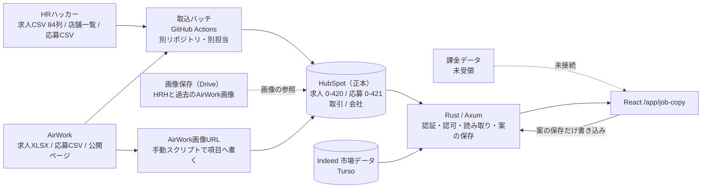
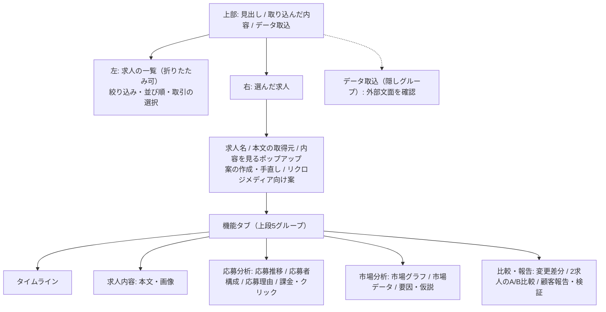

# 求人文面管理 要件と機能の棚卸し

作成日: 2026-10-13。対象は `/app/job-copy`（求人文面管理）。CRM（架電）とは別の画面・別の開発。

この文書は、画面を初めて見る設計担当が UI を根本から考え直すための土台です。コードと既存の docs を読んで書きました。数値のうちコードや docs に無いものは、開発中に HubSpot の読み取りや実機で測った値で、該当箇所に測った日を書いてあります。顧客名・個人名・実在の求人名・URL・秘密値は載せていません。

用語の説明:

- **HRハッカー（HRH）/ AirWork**: 求人を掲載している外部の求人媒体。
- **リクロジメディア**: 自社の求人媒体。ここへ載せる求人案を作る。
- **HubSpot**: 顧客管理サービス。この画面のデータの正本（元になるデータ）。
- **Listing（求人）**: HubSpot の独自オブジェクト `0-420`。媒体の求人 1 件に当たる。
- **版**: ある時点の本文・画像の状態。HubSpot の項目の変更履歴から組み立てる。
- **案**: 求人票作成画面などで作った、まだ掲載していない文面。HubSpot の求人に保存する。
- **シールド**: 給与などの重要項目を、原文のまま写して変えないようにする仕組み。

## 1. 目的と使う人

**目的**: AirWork と HRハッカーの媒体求人について、給与条件・求人票本文・画像の変更を、HubSpot の応募獲得情報、掲載期間・応募期間と同じ時間軸に並べる。そのうえで「なぜその期間に応募が来た／来なかったか」「応募数はいくつか」を比べて分析できるようにする。

さらに次の 2 つを加えて、市場要因を切り分ける。

- 媒体の課金情報（スプレッドシートか CSV。列は未定で、まだ受領していない）
- Indeed の求人数・求職者数（市場の需給。Turso 連携済み）

**現状の不満**: これらを網羅的に一度に見られない。

**UI の最優先事項**:

1. 1 つの求人の全レーン（給与・本文・画像・掲載・応募・課金）を、共通の時間軸で一望できる。
2. 求人どうしを横断して比べられる。

**使う人と判断**: 採用コンサルタントなど社内の担当者。顧客ごとに、求人の文面や条件を変えたことが応募にどう影響したかを確認し、顧客への報告や次の施策を決める。利用者は Google ログインかつ許可リストに載った人だけ（§3 の 9）。

**表現のルール**: 相関と因果を混同しない。「確実に」「必ず」などを使わない（プロジェクト共通のルール）。画面には「変更が応募の増減の原因かどうかは分かりません」という注記が入っている（`MarketFactors.tsx`）。

## 2. データの出どころ

### 2.1 全体の流れ

求人・応募を HubSpot に集める取込バッチは別担当で、このリポジトリの外にある（`docs/architecture/job-pipeline-architecture.md`）。この画面はほぼ読み取り専用で、書き込むのは「案」の保存・確認状態の変更だけ。

### 2.2 HubSpot の主な項目

**求人 Listing（`0-420`）**。一覧の読み取りで使う項目は `src/handlers/job_copy_live/listings.rs` の `PROPERTIES`。

| 項目名 | 意味 |
|---|---|
| `hs_name` | 求人の名前 |
| `id_hrhakkaa` | HRH の求人 ID |
| `id_airwork` / `airwork_account_login_id` | AirWork の求人 ID と、その口座のログイン ID（求人 ID だけだと別会社で重複する） |
| `id_shop_hrhakkaa` | HRH の店舗 ID（事業所） |
| `hrh_kyuujinhyou_honbun` | HRH の求人票本文（84 項目を 1 つの文字列にしたもの） |
| `hrh_kyuujinhyou_gazou` | HRH の画像（URL を 1 行ずつ） |
| `aw_kyuujinhyou_gazou` | AirWork の画像（URL を 1 行ずつ。写真なしは `NO_IMAGES`） |
| `shigotonaiyou` | AirWork の本文 |
| `todoufuken` / `shikuchouson` | 都道府県 / 市区町村 |
| `qinwude` / `zhizhong` / `kyuuyokeitai` / `kinmujikan` / `kyuujitsu` / `guyongxingtai` / `fukurikousei` | AirWork の勤務地・職種・給与形態・勤務時間・休日・雇用形態・福利厚生 |
| `kyuujin_status` | 正規化済みの公開状況（公開前／公開中／公開終了） |
| `baitai_genjoukyou_hrhakkaa` / `baitai_genjoukyou_airwork` | 媒体の生の掲載状況 |
| `saishuu_csv_kenshutsu_bi` | 最終 CSV 検出日（毎日更新され、履歴が残る） |
| `koukai_shuuryou_nichiji` | 公開終了日時（予定日。後述）。公開状況の組み立て側（`listing_status.rs`）で読む |
| `job_copy_drive_manifest_v1` | Drive に保存した画像の参照（HRH と過去の AirWork 画像） |
| `jobgen_draft_body` / `_created_at` / `_status` / `_source` / `_facts` | 案の 5 項目（`src/job_gen/drafts.rs`） |

**応募 Applicant（`0-421`）**。応募理由として読む項目は `applicant_reasons.rs`。

| 項目名 | 意味 |
|---|---|
| `oubodouki` | 応募動機 |
| `ouboriyuu_baitaikisai` | 応募理由（媒体記載の原文） |
| `ouboriyuu_hiaringu` | 応募理由（ヒアリング） |
| `genshokumaeshokukaranotenshokuriyuu` | 現職・前職からの転職理由 |
| `ouboriyuukategori_hiaringu` / `ouboriyuukategori_baitaikisai` | 応募理由カテゴリ（給与／勤務地／職種興味／会社規模／その他／未設定） |
| `yingmuri` | 応募日（任意）。docs による（`job-copy-applicant-reasons-plan.md`） |

性別・年代・地域は、読み取り側で `seibetsu`・`nenrei` などのキーに写している（`applicant_extensions.rs`）。応募者の自由記述は、サーバ側で個人情報をマスクしてから返す。

**取引 Deal・会社 Company**: 顧客の求人かどうかを認可するための関連（Company → Deal → Listing）。一覧の「取引」絞り込みにも使う。

### 2.3 媒体どうしの関係

| 対象 | 同じ求人の根拠 | 扱い |
|---|---|---|
| HRH の求人 | `id_hrhakkaa` | 1 求人 = 1 単位 |
| AirWork の求人 | `airwork_account_login_id` + `id_airwork` | 1 求人 = 1 単位 |
| HRH と AirWork | 結び付けない | 別の求人として並べて比べる |

HRH 版と AirWork 版は、重複扱いを避けるためにわざと文面を変えて出している。そのため同一判定や対応付けはしない。リクロジメディアは自社媒体で、HRH の求人票を基準に案を作る（§3 の 5）。

### 2.4 公開状況の決め方

`src/job_gen/publication.rs` と `listing_status.rs` で正規化する（docs: `job-pipeline-architecture.md` 末尾、2026-10-12 合意）。

- `kyuujin_status`（公開前／公開中／公開終了）を優先し、「掲載前／掲載中／掲載終了」に言い換える。
- 空欄のときだけ生の値を使う。AirWork は `02`=掲載中、`01`=掲載終了。HRH は 公開=掲載中、非公開・公開終了=掲載終了、公開開始前=掲載前。
- 判断できないものは「不明」。
- `koukai_shuuryou_nichiji`（公開終了日時）は予定日で、非公開でも 2027〜2030 年が入る。実際の終了には使わない。公開の帯は「公開開始日から、最後に公開を確認した日（`saishuu_csv_kenshutsu_bi`）まで」で描く。

### 2.5 画像

| 媒体 | 項目 | 中身 |
|---|---|---|
| HRH | `hrh_kyuujinhyou_gazou` | 画像の URL を 1 行ずつ |
| AirWork | `aw_kyuujinhyou_gazou`（2026-10-12 から） | 画像の URL を 1 行ずつ。写真なしは `NO_IMAGES` |

画像そのものは保存せず、HubSpot の項目に URL を入れて表示する。変化は HubSpot の変更履歴で追う。AirWork の URL は手動スクリプト `scripts/job_copy_airwork_image_urls.py` が書く（毎日の自動更新は未実装）。それ以前に Drive へ保存した画像は、`job_copy_drive_manifest_v1` を経由して `/api/job-copy/image` で出す（`docs/architecture/job-copy-drive-storage-contract.md`、`job-copy-airwork-images-results.md`）。

### 2.6 市場・課金

- **Indeed の需給**: 既存の Indeed データ（Turso）。都道府県 × 職種（Indeed の 126 分類）× 月。`GET /api/job-copy/market`（`job_copy_market.rs`）。
- **課金**: 媒体の課金情報は未受領。画面には課金 CSV を取り込む入口があり（`BillingImportPanel.tsx`）、金額・期間・表示回数・クリック数・媒体上の応募数などの形を想定している（`billingTypes.ts`）。取り込んだ内容は再読み込みで消える。HRH の期間別実績の取り込みスクリプトもある（`scripts/job_copy_attach_hrh_performance.py`）が、実求人には実績を入れていない。

## 3. 決定済みの要件

ユーザーが決めたものです。「裏付け」は確認できたコード・docs。

| # | 要件 | 理由 | 裏付け |
|---|---|---|---|
| 1 | 目的と UI 最優先事項は §1 のとおり | 「なぜ応募が来た／来なかったか」を網羅的に一度に見られないため | `JobFeatureTabs.tsx` のタイムライン説明文、`job-pipeline-architecture.md` |
| 2 | 同じ求人の根拠は媒体の求人 ID だけ。HRH は `id_hrhakkaa`、AirWork は `airwork_account_login_id` + `id_airwork`。HRH と AirWork は結び付けない。同じ顧客の求人を並べるのはよい | ID だけだと別会社で重複する。両媒体の文面はわざと変えている | `job-pipeline-architecture.md`「同じ求人とみなす根拠」 |
| 3 | 掲載状況は §2.4 のとおり | 公開終了日時が予定日で、実際の終了を表さないため | `publication.rs`、`listing_status.rs` |
| 4 | 本文の比較は「全文一致で変化を検知 → 項目ごとに特定」。意味の照合はしない。空白・改行コードだけの違いは変更とみなさない | 意味の照合は文脈の例外が増え、説明もしにくかったため | `rikurozi-draft-plan.md`、`diff.ts`、スクショ `job-copy-status/03-whitespace-no-change.png` |
| 5 | リクロジメディア向けの案: HRH の求人票 1 件を基準に生成し、同じ顧客で掲載中の AirWork 求人すべてと重ならない文章にする（対応表は作らない）。給与・勤務地・勤務時間・雇用形態・休日は HRH の値を写して変えない。項目は HRH の 84 列。似すぎ判定は文の一致率 0.2 未満（8 文字未満の文は数えない。200 社 42,975 組の実測で 0.2 以上は 0.7%、暫定）。数字は原文にあるかだけで判定し、無ければ空欄・要確認。HRH CSV の数字コードの対応表は作らず「確認が必要」と出す | 重複掲載の回避と、重要条件の取り違え防止 | `src/job_gen/rikurozi.rs`（しきい値の既定 0.2 と最小文字数 8）、`rikurozi-draft-plan.md`。実測値（42,975 組・0.7%）は 2026-10-11 に開発中に測った値（資料化はしていない） |
| 6 | 画像は HubSpot の項目に URL を入れて表示し、画像そのものは保存しない。変化は HubSpot の変更履歴で追う | HRH と同じ方式にそろえる | `listings.rs` の `AW_IMAGES`、`job-copy-airwork-images-results.md` |
| 7 | UI の言葉に開発者用語を出さない（例「版対応不明」「観測」）。情報を並べすぎない。目的に関係の薄いものは統合・格下げ・非表示 | 利用者が目的を見失うため | `job-copy-ui-polish*.md` |
| 8 | スマホ表示は不要。全部完成した後に直す。確認はパソコン幅 1440・1920 | 優先度 | 各 plan の「PC 幅 1440・1920」 |
| 9 | 利用者は Google ログインかつ許可リスト（`JOB_COPY_ALLOWED_EMAILS`）。顧客の求人は Company → Deal → Listing の関連で認可 | 他の顧客の求人を見せないため | `job_copy_live.rs`（`authorized_user`）、`listings.rs`（関連の確認） |
| 10 | CRM（架電）とは別の画面・別の開発 | 担当と変更頻度が違う | `docs/architecture/job-copy-*.md` が CRM を変更しないと明記 |

## 4. いまある機能の一覧

### 4.1 画面の構成

タブの定義は `frontend/src/screens/job-copy/JobFeatureTabs.tsx`、画面の組み立ては `JobCopyScreen.tsx`。求人票作成画面（`/app/jobgen`）から案を保存して、この画面へ戻ってくる経路もある。

### 4.2 一覧と絞り込み（画面左）

| 機能 | 見えること・できること | 使う API |
|---|---|---|
| HubSpot の求人一覧 | 50 件ずつのページ送り。媒体（HRH／AirWork）、公開状況、案の状態を表示 | `GET /api/job-copy/listings` |
| 絞り込み | 都道府県、職種の分類（Indeed の分類）、媒体、公開状況、案の状態、取引、取引名の検索 | 同上（クエリ `prefecture` `title` `media` `publication` `draft_status` `deal` `deal_search`） |
| 並び順 | 職種・勤務地・給与・勤務時間・休日・本文変更日・公開状況・応募数など | 同上（`sort` `descending`） |
| 取引の横断比較 | 取引を選び、その取引の求人を並べて「違う項目」を確認。表示する列を選べる | `GET /api/job-copy/listing-comparison`、`GET /api/job-copy/listing-body-dates` |
| 公開状況の一覧 | 固定スナップショットの各求人の公開状況 | `GET /api/job-copy/listing-status` |
| 固定一覧（36 求人） | 手で作った固定ファイルの求人。一覧・カードの表示切り替え | `GET /api/job-copy/moc` |
| 一覧の折りたたみ | 通常は 48px の帯に畳み、必要なときだけ重ねて開く。固定もできる | （画面のみ）`job-copy-collapsible-sidebar-plan.md` |

### 4.3 求人ヘッダー（選んだ求人の上）

| 機能 | 見えること・できること | 使う API |
|---|---|---|
| 内容ポップアップ | 求人名の横から開く。本文（項目別）、画像（HRH・AirWork）、記載のない任意項目、1 つ前に記録された本文との変更点。矢印キーで前後の求人へ | `GET /api/job-copy/listings/{id}/versions`、`GET /api/job-copy/image` |
| 案の作成・保存 | 求人票作成画面で作った案を、求人に「確認待ち」で保存。掲載中の本文は変えない | `POST /api/job-copy/listings/{id}/draft` |
| 案の採用／見送り | 最新の案の確認状態を変更 | `PATCH /api/job-copy/listings/{id}/draft` |
| 保存の結果確認 | 通信が不確かなときに保存の結果を確かめる。HubSpot の一時障害は再送台帳で再送 | `GET /api/job-copy/draft-operations/{id}` |
| 手直し | 求人票の 84 項目を手で直して案として保存。募集条件に関わる変更は理由が必要 | `POST /api/job-copy/listings/{id}/manual-draft` |
| リクロジメディア向け案 | HRH 求人から、重ならない文面の案を生成。確認用 CSV をダウンロード（HubSpot へは書かない） | `POST /api/job-copy/listings/{id}/rikurozi-draft` |

案の保存系は既定で停止している。`JOB_COPY_DRAFT_WRITES_ENABLED` か `JOB_COPY_DRAFT_WRITE_ALLOWLIST` で有効にする（`jobgen-to-job-copy.md`）。

### 4.4 機能タブ

| タブ | 見えること・できること | 使う API |
|---|---|---|
| タイムライン | 1 求人のレーンを共通の日付軸に並べる。レーンは「媒体の公開状況」「掲載期間」「給与」「本文」「画像」「課金」「応募」「応募理由」「市場」。本文・画像・給与の変化は印で示す。応募は日／週／月で集計 | `versions`、`applications`、`market`、`listing-status` |
| 求人内容: 本文・画像 | 日時の一覧から版を選び、その時点の本文（項目別）と画像を読む。応募の件数の内訳も添える | `versions`、`image`、`snapshot-image` |
| 応募推移 | 応募日の分かる実績を月別の棒グラフで表示。応募日が不明なものは別に数える | `applications` |
| 応募者構成 | 性別・年代・地域の構成。本文ごとの違い。「応募者の条件から求人を探す」逆引き | `applications`（固定一覧は `moc`） |
| 応募理由 | 応募動機・媒体記載・ヒアリングを出典別に表示。カテゴリ別の集計。自由記述は内部閲覧用で、折りたたみ | `applications` |
| 課金・クリック | HRH の期間別実績（表示回数・クリック・費用など）と取り込んだ課金 CSV。未接続のデータは出さない。0 とは区別する | （取り込み済みデータ。専用 API なし） |
| 市場グラフ／市場データ | 市場の職種と都道府県を選び、月次の指標を折れ線・棒グラフと数値表で表示。求人の職種・県から自動で初期選択 | `GET /api/job-copy/market` |
| 要因・仮説 | 本文・画像を確認した履歴と、同時に確認する変数（文面・給与・課金・市場・掲載期間・選考の連絡速度・会社の認知）の整理 | （表示のみ） |
| 変更差分 | 同じ求人の 2 つの版（案を含む）を比較。本文は全文一致で検知し、項目の列で特定。画像の差し替え・並び順・中身の比較。元データの原文も開ける | `versions` |
| 2 求人の A/B 比較 | 2 つの求人を選び、版ごとに独立した実績を並べる。比較名・仮説・組み合わせの確認を記録（画面内のみ） | `versions`、`applications` |
| 顧客報告・検証 | 何を変えたか、比較期間の応募、費用と応募単価、仮説 → 実施 → 結果 → 次の施策の記録欄。HubSpot には保存せず、切り替えで消える | （表示のみ） |

### 4.5 データ取込

画面上部の「データ取込」の中にある。

| 機能 | できること | 使う API |
|---|---|---|
| HubSpot の取引先・求人・応募を確認 | 取引先を指定して、求人と応募を読み込む（1 求人ずつ開く） | `GET /api/job-copy/live` |
| 媒体から取得したデータの取り込み | 媒体から取得した JSON（1〜59 求人、32MB まで）を読み込む | なし（ブラウザ内） |
| 課金 CSV | 課金情報を求人に結び付けて取り込む。再読み込みで消える | なし（ブラウザ内） |
| 外部文面を確認 | 外部から届いた本文を、選んでいる求人の現在の本文と照合する。本文の直接編集ではない | なし（ブラウザ内） |

### 4.6 その他

- 画像は同一オリジンの `GET /api/job-copy/image`（Drive の不変な保存物。顧客との関連を確認してから返す）と `GET /api/job-copy/snapshot-image`（固定一覧の画像）から出す。
- サーバ内の部品: Drive 読み取り（`job_copy_drive.rs`）、画像の参照橋渡し（`job_copy_image_bridge.rs`）、媒体取得物の橋渡し（`job_copy_capture.rs`）、市場（`job_copy_market.rs`）。

### 4.7 スクリーンショット（既存のもの）

撮り直してはいません。いずれも架空データです。

- 一覧と公開状況: [一覧](../screenshots/job-copy-status/01-list-statuses.png)、[内容ポップアップ](../screenshots/job-copy-status/02-popup-summary.png)
- ポップアップ v2: [2 列表示](../screenshots/job-copy-listing-popup-v2/v2-01-two-columns.png)、[画像付き](../screenshots/job-copy-listing-popup-v2/v2-08-airwork-images.png)
- 取引の横断比較: [絞り込み](../screenshots/job-copy-deal-compare/01-deal-filter-1440.png)、[比較表](../screenshots/job-copy-deal-compare/02-deal-table-1440.png)
- 管理・修正・比較: [管理](../screenshots/job-copy-manage-edit-flow/01-manage-1440.png)、[比較](../screenshots/job-copy-manage-edit-flow/03-compare-1440.png)
- AirWork の画像: [本文と 5 枚](../screenshots/job-copy-airwork-image-urls/01-body-five-images.png)

## 5. わかっている問題

これまでに分かった問題:

- 一覧で求人をクリックしてから表示完了まで 5〜6 秒かかる。原因を計測中。
- 情報が乱立していて、目的（期間 × 応募の比較）が一目で分からない、という評価。
- AirWork は本文以外の多くの任意項目が「取得できていません」になる（データ源に無い項目が多い）。
- 掲載中の AirWork 1,330 件のうち、公開ページが無い求人が 343 件ある。多くは契約が有効なまま求人だけ終了し、HubSpot の「掲載中」が更新されていないと見られる。
- 採用サイト URL が HubSpot に無い AirWork 求人が 187 件（53 口座）。
- HRH の画像項目にファイル名だけが入っていて、表示できない求人がある。
- 課金データが未受領。毎日の画像 URL 自動更新が未実装（手動スクリプトのみ）。
- 公開状況「不明」が HRH に 44 件残る。

（上の件数は 2026-10-12 に HubSpot の読み取りと公開ページの確認で測った値、所要時間は利用者の体感です。）

コード・docs から見えるもの:

- 取り込んだ課金 CSV、顧客報告の記録欄、A/B 比較の選択は画面内だけに残り、再読み込みで消える（`BillingImportPanel.tsx`、`ConsultantReview.tsx`）。
- 画面の入口が多く、同じ求人を見る経路が重なっている。タブは 5 グループ・11 機能あり、一覧は HubSpot 一覧と固定一覧（36 求人）の 2 系統がある。
- 固定一覧（`/api/job-copy/moc`）は手で作ったファイルで、HubSpot の履歴から版を組み立てる形への切り替えは途中（`job-pipeline-architecture.md`）。
- 初期表示の遅さは過去にも調べている。固定スナップショットの 28 求人の画像解決で約 16 秒かかったため、遅延解決に変えた（`job-copy-loading-performance-plan.md`）。今回の 5〜6 秒とは別の計測が必要。
- 画像の保存上限は、保存側 100 枚と原本確認側 3 枚で食い違っていたため 100 にそろえた（`job-copy-airwork-images-plan.md`）。
- HubSpot の変更履歴は 1 項目あたり 20 件までの可能性があり、長期の履歴は要確認（`job-pipeline-architecture.md`）。

## 6. 未決事項・後回しにしたもの

- 課金データの受け取り方と列の形式（未受領）。受領後、課金レーンと費用・応募単価の算出を本番データにつなぐ。
- AirWork 画像 URL の毎日の自動更新（現状は手動）。
- 似すぎ判定のしきい値 0.2 は暫定。
- リクロジメディアへの CSV の受け渡し方、閉じる指示の渡し方（先方と協議中。`rikurozi-media-api-spec.md`）。
- 事業所の契約終了を HubSpot の取引から確実に判定できるか。
- HRH の応募者の詳細ページ項目の取り込み（別担当が作業中）。
- 逆引き検索で LLM を使うか（現在は外部 LLM へ原文を送らない）。
- スマホ表示（全体が完成した後）。
- 顧客報告・検証の記録を保存するか（現在は画面内のみ。HubSpot へ書かない方針）。
- 案の再送の保存先は、既存の監査 DB の専用表（ADR-019）。複数インスタンスにする場合は排他が必要。

## 7. 関連資料

全て `docs/architecture/` にあります。

**全体・設計**

- [job-pipeline-architecture.md](../architecture/job-pipeline-architecture.md): 求人・応募の連携の全体像（最初に読む）
- [job-copy-app-integration-handoff.md](../architecture/job-copy-app-integration-handoff.md)、[job-copy-react-join-plan.md](../architecture/job-copy-react-join-plan.md)、[job-copy-react-join-results.md](../architecture/job-copy-react-join-results.md): アプリへの組み込み
- [job-copy-hubspot-listings-plan.md](../architecture/job-copy-hubspot-listings-plan.md)、[job-copy-hubspot-ui-review.md](../architecture/job-copy-hubspot-ui-review.md): HubSpot の求人一覧

**機能別**

- [job-copy-functional-tabs-plan.md](../architecture/job-copy-functional-tabs-plan.md): 機能別タブ
- [job-copy-deal-compare-plan.md](../architecture/job-copy-deal-compare-plan.md)、[job-copy-ab-comparison-plan.md](../architecture/job-copy-ab-comparison-plan.md)、[job-copy-ab-comparison-results.md](../architecture/job-copy-ab-comparison-results.md): 比較
- [job-copy-listing-popup-plan.md](../architecture/job-copy-listing-popup-plan.md)、[job-copy-listing-popup-v2-plan.md](../architecture/job-copy-listing-popup-v2-plan.md): ポップアップ
- [job-copy-manage-edit-flow-plan.md](../architecture/job-copy-manage-edit-flow-plan.md)、[jobgen-to-job-copy.md](../architecture/jobgen-to-job-copy.md): 案の作成・保存・修正（ADR-019 を含む）
- [job-copy-applicant-reasons-plan.md](../architecture/job-copy-applicant-reasons-plan.md)、[job-copy-reactions-performance-plan.md](../architecture/job-copy-reactions-performance-plan.md)、[job-copy-reactions-performance-handoff.md](../architecture/job-copy-reactions-performance-handoff.md)、[job-copy-reactions-performance-results.md](../architecture/job-copy-reactions-performance-results.md): 応募理由・媒体実績・逆引き
- [job-copy-market-charts-plan.md](../architecture/job-copy-market-charts-plan.md)、[job-copy-market-charts-results.md](../architecture/job-copy-market-charts-results.md): 市場グラフ
- [job-copy-realdata-findings.md](../architecture/job-copy-realdata-findings.md): 実データで見つかった表示・生成の修正

**リクロジメディア**

- [rikurozi-draft-plan.md](../architecture/rikurozi-draft-plan.md)、[rikurozi-media-api-spec.md](../architecture/rikurozi-media-api-spec.md)

**画像・Drive**

- [job-copy-drive-storage-contract.md](../architecture/job-copy-drive-storage-contract.md)、[job-copy-drive-integration-handoff.md](../architecture/job-copy-drive-integration-handoff.md)、[job-copy-drive-continuation-plan.md](../architecture/job-copy-drive-continuation-plan.md)、[job-copy-drive-expansion-results.md](../architecture/job-copy-drive-expansion-results.md)
- [job-copy-airwork-images-plan.md](../architecture/job-copy-airwork-images-plan.md)、[job-copy-airwork-images-results.md](../architecture/job-copy-airwork-images-results.md)

**表示・性能**

- [job-copy-ui-polish.md](../architecture/job-copy-ui-polish.md)、[job-copy-ui-polish-2.md](../architecture/job-copy-ui-polish-2.md)、[job-copy-ux-self-audit.md](../architecture/job-copy-ux-self-audit.md)、[job-copy-collapsible-sidebar-plan.md](../architecture/job-copy-collapsible-sidebar-plan.md)
- [job-copy-loading-performance-plan.md](../architecture/job-copy-loading-performance-plan.md)、[job-copy-loading-recovery-plan.md](../architecture/job-copy-loading-recovery-plan.md)
