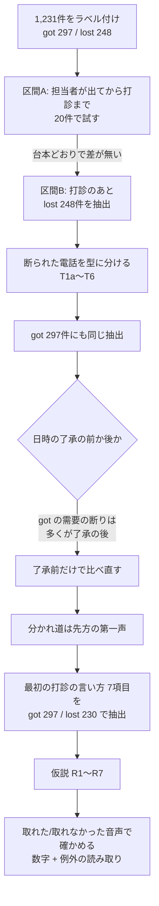

# アポが取れるトークの仮説 v0(教師: 佐藤・斎藤)

作成: 2026-10-13
対象範囲: 新規営業のテレアポ通話(Zoom Phone の録音と文字起こし)。教師は佐藤萌・斎藤航輝、期間は 2026-06-01〜10-09
状態: 仮説。少数データ(2名・4か月強)で作ったもの。大規模データで確かめる前の基準点。

この文書の目的は、今後、大規模データで計測して仮説が成り立たなかったときに、ここまで戻ってやり直せるようにすること。何を、どの定義で、どう決めたかを残す。

---

## 1. 論点の切り分け

アポ分析は次の4つに分ける。混ぜて分析しない(2026-10-13 ユーザー決定)。

| # | 論点 | 誰の課題か | この文書で扱うか |
|---|---|---|---|
| ① | 電話のトークでアポが取れるか | メンバーの戦術 | **扱う(主題)** |
| ② | 取れたアポがその後どうなったか(熱いアポの定義) | ③の材料 | 扱わない。HubSpot の現在ステージでの区分案だけ作った(付録 B) |
| ③ | 熱いアポになる先をどう見分け、リストを作るか | 経営の戦略・戦術 | 扱わない。架電前データの棚卸しだけ行った(付録 B) |
| ④ | 取れていない人の音声を教師と比べ、改善点を出すシステム | ①の成果を使う | 扱わない。①が固まってから別に設計する |

①では、相手の質(熱さ・需要の有無)を理由にトークの評価を割り引かない。相手の質は②③の論点として扱う。

---

## 2. データ

### 2.1 母集団(実際のアポ率)

期間: 2026-06-01〜10-09。Zoom Phone の通話履歴から集計した。

| 担当 | 全発信 | 回線がつながった | 70秒以上 | アポが入った案件 | アポ ÷ 全発信 |
|---|---|---|---|---|---|
| 佐藤萌 | 7,084 | 6,234 | 2,385 | 142 | 2.0% |
| 斎藤航輝 | 10,926 | 9,851 | 3,689 | 156 | 1.4% |

- 「回線がつながった」には、受付が出ただけの電話も含む。
- 2.0% と 1.4% は想定どおりの値(ユーザー確認済み)。

### 2.2 分析用に抜いた電話(1,231件)

母集団の比率は保っていない。「取れた電話」と「取れなかった電話」を比べるために、それぞれ集めた。

| 群 | 件数 | 取り方 |
|---|---|---|
| アポにつながった案件の電話 | 827件(298案件) | HubSpot でアポ日確定のステージ(51997752 / 52035886)に入った案件ごとに、入る**前**14日以内に、同じ担当が案件の電話番号にかけた電話。つながっていて録音があるもの |
| アポにつながらなかった電話 | 596件 | 70秒以上つながった電話のうち、14日以内にアポのステージに入らなかったもの(5,102件)から抜いた。担当×月で層を分け、アポ側の2倍の数を取った。同じ番号からは1件だけ、seed 20261009 |
| 文字起こしが取れたもの | 1,231件 | Zoom の文字起こし API。録音 ID はハイフンを外す |

- 実際は、取れた1本に対して取れなかった電話が約50本ある。この1,231件の中では1対2。
- そのため、この中の「取れた割合」はアポ率ではない。確率を出すときは、この比率で補正する。

### 2.3 ラベル(文字起こしの中身で判定)

定義は `specs/label_spec.md`(2026-10-13 合意)。判定は Sonnet が文字起こしを読んで行った。

- 試しの40件では、Haiku は6件が Sonnet とずれた。ずれた6件は、私が読んで全部 Sonnet が正しいと判断した。そのため全件 Sonnet にした。
- 外部の API には送っていない。

| ラベル | 意味 | 件数 |
|---|---|---|
| got | この電話で新しい面談の日時が決まり、先方が了承した | 297 |
| lost | 日程を持ちかけたが、断られたか決まらなかった | 248 |
| ended_before_proposal | 日程を持ちかける前に終わった | 114 |
| tentative | 候補は出たが、先方が保留した | 27 |
| excluded | 不在 440、既存アポの確認・リスケ 77、その他 26、雑音 2 | 545 |

前提にした知識:

- **既存感:** 初めての相手にも「前回〇〇の件で」「ご無沙汰しております」と入るのが基本のトーク。この言い方だけで「再接触」とは判定しない。
- **熱くないアポ:** 先方が日時に了承したあとでも、成約しそうにない「熱くないアポ」は営業から取り下げる運用がある。先方が日時に了承していた場合だけ「営業が見送った」として別枠にする。

---

## 3. 分析の流れと、その時点の判断

| 段階 | 分かったこと | その時点の判断 |
|---|---|---|
| 区間A(担当者が出てから打診まで)を20件で試す | 取れた電話も断られた電話も同じ台本だった。担当者が出ると、ひと続きの発言で「ご無沙汰 → 前回〇月の件 → 改めて → 〇日〇時か〇時」と打診まで言う。打診前の断り・質問はほぼ0 | 比べる区間を打診のあと(B)に移す |
| 断られた248件の B を抽出 | 打診が1回で終わった電話が156/240。断りへの返しで一番多いのは状況の質問 | 断られた電話を型に分ける(4章) |
| 取れた297件の B を抽出 | 取れた側も断りを受けていた(断りなしは21件だけ) | 断りの種類ごとに返しを比べる |
| 日時の了承の秒を抽出 | 取れた側の「足りている」「募集なし」などは、多くが日時の了承の**後**に出ていた | 了承の前だけで比べ直す(5章) |
| 4つの型を10件ずつ読み比べ | 取れた側だけに出る言い回しがある(R5、R7 の例) | 打診の言い方の抽出へ進む |
| 最初の打診の言い方を527件で抽出 | 職種名を出すと取れにくく、今かける理由を言うと取れやすい | 仮説 R1〜R7 にまとめる |
| 確かめ | 数字は佐藤・斎藤とも同じ向き。例外32件に、仮説の向きを覆すものは無かった | v0 として固定(この文書) |

---

## 4. 断られた電話の型(打診のあった240件)

| 型 | 件数 | 主な終わり方 |
|---|---|---|
| T1a 営業が見送った(熱くないアポ。先方は日時に了承していた) | 10 | 営業が取り下げた |
| T1b 先方が崩した(日時に了承したあと、先方が断った) | 8 | |
| T2a 募集がない | 65 | 営業が引いた 49 |
| T2b-1 足りている | 34 | 営業が引いた |
| T2b-2 他社で進行中 | 48 | 営業が引いた |
| T2c お金をかけない | 12 | 営業が引いた |
| T3 日程が合わない(理由が日程だけ) | 26 | 時期を決めて再連絡 19 |
| T4 興味がない | 12 | 先方が打ち切った |
| T5 担当違い・決める人が別 | 14 | 別の担当を紹介された |
| T6 その他 | 11 | |

- 打診のなかった8件は除いた。面談後のフォロー電話や、商談の録音が混ざっていたため。
- T1a は営業の判断として、このあとの比較から除いた。

---

## 5. 分かれ道は先方の第一声

### 5.1 日時の了承の前に出た断り

| 断りの種類 | 取れた297件の中 | 断られた230件の中 |
|---|---|---|
| 忙しい・日が合わない | 223 | 116 |
| 足りている・他社で進行中 | 18 | 94 |
| 募集がない | 11 | 67 |
| お金をかけない | 12 | 35 |
| 興味がない | 8 | 63 |

- 取れた電話のほとんどは、「打診 →『その日は無理』→ 別の日時(94%)→ 了承」という流れだった。
- 取れた電話にも需要の断りは出ていたが、多くは日時の了承の後に出ていた。前後を分けずに比べると、取れた側の返しが実際より強く見える(初回の集計はこの偏りを含んでいた)。
- 日時の了承までに営業がした状況の質問は、取れた側が中央値0回、断られた側は平均2回。
- 担当者の名前を呼んだ回数は、どちらも2回で差が無い(「名前を呼ぶほど取れる」は支持されなかった)。

### 5.2 先方の第一声

| 打診の直後の先方の第一声 | 件数 | 取れた割合 |
|---|---|---|
| 了承 | 46 | 96% |
| 日程の話 | 302 | 65% |
| 質問(何の件?どういう会社?) | 73 | 41% |
| 需要の断り | 72 | 12% |

取れた割合は527件の中の割合。全体は56%。

---

## 6. 仮説 R1〜R7

> **2026-10-16 追記: R1〜R7 と佐藤型・斎藤型の実例は、前後の流れごとに [冒頭](knowledge_opening.md)・[今かける理由](knowledge_whynow.md)・[切り返し](knowledge_counter.md) の実例集にまとめました。**

| # | 場面 | 仮説 | 音声からの判定のしかた |
|---|---|---|---|
| R1 | 最初の打診 | 前回の件は時期で言い、職種名は出さない。**ただし**先方が今募集している職種が分かっていれば出してよい | 「前回〇〇の件で」の〇〇に職種名があるか |
| R2 | 最初の打診 | 今かける理由を添える。一番強いのは、先方が前に言った時期(「お盆明けと伺っていたので」)。無ければ「サービスが新しくなった」 | 「改めて」以外の理由を言ったか |
| R3 | 第一声が日程の話 | 別の日時を出す。2〜3回ずらしてよい | 日程の断りの直後に別の日時を出したか |
| R4 | 第一声が一部だけの断り(その職種・その拠点は募集なし) | 他に募集している職種・拠点を聞いて切り替え、打診し直す | 限られた断りのあとに、別の職種・拠点の質問と再打診があるか |
| R5 | 第一声が需要の断り(足りている・他社で・お金をかけない・興味がない) | 状況の質問だけで終わらせず、サービスの説明かハードルを下げる一言で返し、日付を変えて打診し直す | 最初の需要の断りへの返しに説明かハードル下げがあり、その場で引いていないか |
| R6 | 事実に基づく断りが続く(募集予定なし・他社で決定済み) | 同じ断りが3回出たら打診をやめ、次に動く時期を聞いて、日付付きで再連絡を約束する | 同じ断りの3回目以降に何をしたか |
| R7 | サービスの説明 | 肯定形で言う(「採用代行に近い」「媒体選びから運用まで」)。「人材紹介ではない」「人材紹介と似ている」と言わない。相手の記憶を否定しない | 説明の言い方 |

R5 で取れた側に出ていた言い回しの例:

- 判断を相手に渡す: 「合わなければ会わないとおっしゃっていただいて問題ない」「〇〇さんにご判断いただきたい」
- 相手の心配にそのまま答える: 「工数をかけたくない」と言われて「工数がかかるようなサービスではない」

R7 に関わる、断られた側に出ていた言い回しの例:

- 「人材紹介とほぼ同じ」と言って、直後に切られた
- 「お断りしてるはず」と言う相手に「言っていただいてたんですよね」と返し、切られた
- 「今年度は厳しそうですか」のように「はい」と答えやすい質問をして、そのまま引いた

---

## 7. 取れた音声と取れなかった音声での確かめ

### 7.1 数字

527件(取れた297件 / 断られた230件)。差の幅は、ブートストラップ2,000回の95%区間。

| 仮説 | 担当 | 守った | 守らない | 差の95%区間 |
|---|---|---|---|---|
| R1 | 佐藤 | 63%(156件) | 46%(95件) | +4〜+29% |
| R1 | 斎藤 | 81%(64件) | 49%(212件) | +21〜+44% |
| R2 | 佐藤 | 64%(162件) | 44%(89件) | +7〜+32% |
| R2 | 斎藤 | 83%(30件) | 53%(246件) | +15〜+44% |
| R5 | 佐藤 | 60%(20件) | 7%(92件) | +31〜+76% |
| R5 | 斎藤 | 38%(42件) | 10%(67件) | +11〜+44% |

R1 と R2 を守った数で分けた結果:

| 担当 | 0個 | 1個 | 2個 | AUC |
|---|---|---|---|---|
| 佐藤 | 35%(54件) | 59%(76件) | 64%(121件) | 0.61 |
| 斎藤 | 48%(203件) | 71%(52件) | 95%(21件) | 0.62 |

- AUC は、取れた電話と取れなかった電話を見分ける力の目安。0.5 が当てずっぽう、1.0 が完全。
- 打診の言い方の2つだけで0.6強。残りは、そのあとの返し方(R3〜R7)で決まると考えている。
- R3 の数字は、取れた側が日程の断りの94%に別の日時で返している、というところまで。断られた側は60%。
- R4・R6・R7 は、例外を読んで出てきた条件で、まだ件数では確かめていない。

### 7.2 例外の読み取り

仮説に当てはまらない電話を、各8件読んだ。

| 例外の種類 | 読んで分かったこと |
|---|---|
| 職種名を言い、今かける理由なしで取れた | 先方に今の募集があり、職種が合っていた。R1 に「ただし」を足した |
| 職種名を言わず、今かける理由ありで取れなかった | 先方の事情(募集なし・繁忙・他社で充足・以前試して成果なし)だった |
| 需要の断りに説明かハードル下げで返したのに取れなかった | 事実に基づく断り(募集なし・予算なし・他社で決定済み)、再打診が抜けていた、粘りすぎ(「しつこく来られると」)、「紹介ではない」と否定形で入って切られた。ここから R6・R7 ができた |
| 説明もハードル下げもせずに取れた | 断りが特定の職種・拠点だけだった。または日程の断りだった。ここから R4 ができた |

例外の中に、仮説の向きを覆すものは無かった。どれも条件を足せば説明できた。

### 7.3 527件すべてを R1〜R7 で判定した結果(追記 2026-10-13)

判定の定義は `specs/rules_spec.md`。判定は Sonnet が全文を読んで行った。見る範囲は、先方が最終的な日時に了承するまで。

| 仮説 | 守った | 守らなかった | その場面が無い | 佐藤 守った/守らなかった | 斎藤 守った/守らなかった |
|---|---|---|---|---|---|
| R1 職種名を出さない | 66%(187) | 48%(319) | 95%(21) | 63% / 47% | 78% / 49% |
| R2 今かける理由 | 64%(241) | 50%(282) | 75%(4) | 61% / 40% | 74% / 52% |
| R3 日程の断りに別日時 | 74%(293) | 12%(41) | 39%(193) | 73% / 12% | 75% / 12% |
| R4 一部の断りは切り替え | 47%(15) | 0%(10) | 58%(502) | 件数が少ない | 件数が少ない |
| R5 需要の断りに説明・ハードル下げ+再打診 | 57%(60) | 1%(152) | 83%(315) | 76% / 0% | 46% / 3% |
| R6 同じ断り3回で時期を聞いて再連絡 | 0%(5) | 6%(17) | 59%(505) | 件数が少ない | 件数が少ない |
| R7 肯定形で説明・記憶を否定しない | 57%(81) | 39%(85) | 60%(361) | 50% / 48% | 62% / 34% |

担当を入れ替えて確かめた結果。片方の担当のデータで各ルールの重みを決め、もう片方に当てはめて AUC を出した。

| 重みを決めたデータ → 当てはめたデータ | R1〜R7 | R1・R2 だけ | R3〜R7 だけ |
|---|---|---|---|
| 佐藤 → 斎藤 | 0.88 | 0.62 | 0.87 |
| 斎藤 → 佐藤 | 0.92 | 0.61 | 0.91 |

読み方:

- R1・R2・R3・R5 は、2人とも同じ向きに出た。
- R3・R5 には「打診し直したか」が入っている。打診し直さなければ日時は決まらないので、取れたかどうかと一部が重なっている。そのため、R3〜R7 の AUC 0.9 前後は高めに出ている。重なりの無い R1・R2 だけでは 0.6 強。
- R4 は件数が少ないが、向きは仮説どおり(切り替えなかった10件は全部取れなかった)。
- R6 は守っても守らなくてもほぼ取れていない。この電話でアポを取るためのルールではなく、次の電話への布石として扱う方がよい。
- R7 は斎藤では差が出たが、佐藤ではほぼ差が無い。

### 7.4 現場の意見から足した要素 R8〜R10(追記 2026-10-13)

現場に R1〜R6 を見せたところ、筋が良いという反応だった。あわせて、次の3つの要素が挙がった。

- テンションが高いか
- 相手の NO に、リアクションを取ってから切り返すか
- 相手のアウトに対して、会話が噛み合っていないパターンがあるか

判定の定義は `specs/rules2_spec.md`。先方のアウト(断り・質問・前回の否定)1つごとに判定した。テンションは、今回は文字から読める範囲だけで判定した。

| 要素 | 区分 | 取れた割合 | 佐藤 | 斎藤 |
|---|---|---|---|---|
| R8 テンション(文字から) | 高い | 86%(36) | 94% | 78% |
| | 普通 | 59%(443) | 59% | 59% |
| | 低い | 8%(48) | 14% | 0% |
| R9 日程以外のアウトへの最初の反応 | 受けてから返す | 36%(190) | 31% | 40% |
| | いきなり返す | 36%(73) | 21% | 41% |
| | 受けて引く | 0%(29) | 0% | 0% |
| R10 噛み合い | アウトに全部噛み合っている | 59%(394) | 53% | 65% |
| | 噛み合わない返しがある | 30%(97) | 50% | 22% |

話す速さは、日時の了承までの営業の発話で、文字起こしの秒から計算した。

| 担当 | 取れた | 断られた |
|---|---|---|
| 佐藤 | 6.2字/秒 | 6.7字/秒 |
| 斎藤 | 5.4字/秒 | 5.8字/秒 |

読み方:

- R8 は2人とも同じ向き。文字からの判定なので、うまくいったから声が弾んだ、という逆向きも混ざりうる。
- R9 は文字からは差が出なかった。現場の言う「リアクション」は、言葉の有無ではなく、間や声の調子かもしれない。
- R10 は斎藤で大きな差、佐藤ではほぼ差が無い。R7 とまったく同じ出方だった。
  - R7 を守らなかった85件のうち43件は、R10 でも噛み合わない返しがあった。R7 を守った80件では18件だった。
  - ユーザーの見立て「R7 は R8〜R10 を抽象度高くしたもの」と合う。

## 6章の仮説の整理(v0.1)

| # | 扱い |
|---|---|
| R1〜R5 | アポが取れるかの仮説として残す。教師データの項目にする |
| R6 | 現場では筋が良いとされた。ただし、この電話で取れたかでは差が出ない(場面に当たった22件のうち、取れたのは1件)。次の電話で取れたかで確かめる仮説として、別の枠にする。今の教師データには入れない |
| R7 | 単独のルールにはせず、R10 の具体例として R10 に含める |
| R8 | 残す。本番の入力は音声ファイルになるので、声の高さ・抑揚・大きさ・話す速さを録音から測るのが本筋。録音の解析は後回しにする(2026-10-13 ユーザー判断) |
| R9 | 文字からは差が無い。録音の解析で、間や声の調子として測り直す候補 |
| R10 | 残す。佐藤で差が出ない理由は未解明(テンションなど別の要素で押し切れている可能性) |

---

## 7.5 弱い側8名との比較と、その逆証明(追記 2026-10-14)

### 対象とデータ

- 弱い側8名: 山口・北澤・横山・若松・田中・伊藤(慶将)・家村・伊藤(可笑)。期間は 2026-09-01〜10-12(ユーザー指定)。
- アポ率は「本人の電話起点」で数えた: 本人がつながって70秒以上話した電話から、3営業日以内にアポ日確定になったもの。
  - 担当案件で数えると、外部アポインター(medica_cc* など)が取ったアポが担当営業の数に入ってしまうため。
  - 祝日は営業日から除いていない。

| 営業 | 発信 | 本人の電話起点のアポ | 率 |
|---|---|---|---|
| 佐藤(教師) | 1,283 | 37 | 2.9% |
| 斎藤(教師) | 1,753 | 35 | 2.0% |
| 横山 | 1,449 | 24 | 1.7% |
| 山口 | 1,186 | 15 | 1.3% |
| 北澤 | 1,843 | 23 | 1.2% |
| 若松 | 958 | 11 | 1.1% |
| 家村 | 1,278 | 8 | 0.6% |
| 伊藤(慶将) | 1,242 | 4 | 0.3% |
| 伊藤(可笑) | 1,309 | 2 | 0.2% |
| 田中 | 884 | 0 | 0.0% |

分析用の電話の選び方:

- 8名それぞれについて、アポを取った電話は全部、取れなかった電話は無作為に60件を選んだ(70秒以上・録音あり・同じ番号は1件、seed 20261014)。合計567件。
- 教師と同じラベル基準で判定した結果、取れた74件、断られた179件になった。
- この253件を、打診の言い方・R1〜R7・R8〜R10 で判定した。
  - 判定のやり方: 3つの定義を1回の判定でまとめて当てはめた。

### 逆証明で分かったこと

| 確かめたこと | 結果 |
|---|---|
| 判定のやり方の違いでずれないか | 教師40件を、8名と同じやり方で判定し直して、前の判定と比べた。一致は R2 40/40、R1 39/40、R10 38/40、R5 37/40、第一声 37/40、R3 36/40、テンション 35/40、R7 32/40。R7 以外は差を説明できるほどのずれは無い。R7 はぶれが大きく、単独では使えない |
| 取れた/断られたの比率の偏り | 8名側は断られた電話の割合が高いので、取れた電話の中・断られた電話の中に分けて比べ直した |
| R5(需要の断りへの返し)の差 | **取り消し。** 断られた電話の中、同じ9〜10月で比べると、教師 4%・8名 6% で差が無い。最初に見えた差(28% 対 8%)は、教師側に取れた電話が多いことによる偏りだった |
| R2(今かける理由)の差 | 偏りを除いても残る(取れた電話の中 教師52〜56% 対 8名26%、断られた電話の中 38〜50% 対 15%)。ただし、断られた電話の中の割合は佐藤69%・斎藤10%で、**差は佐藤一人による**。斎藤は8名と同じ程度。同じ人の中で比べると言った方が取れる(教師・8名とも同じ向き)ので仮説としては残すが、教師と弱い人を分けるものとは言えない |
| R3(日程の断りに別の日時)の差 | 断られた電話の中で、教師68〜76% 対 8名54%。中くらいの差 |
| R1・R10 | 8名も教師と同じかそれ以上に守っている。教師と弱い人を分けるものではない |
| 仮説の向き | 8名の中だけで比べても、R1・R2・R3・R5・R10 はすべて教師と同じ向き(守った方が取れている) |
| 人単位の並び | 10名の、守った割合とアポ率の順位相関は、打診まで行く割合 -0.05、R2 0.24、R3 0.08、R5 0.24。どれも人の並びは説明できない(10名だけ) |
| 打診まで行けているか | 担当者と話せた電話のうち、打診まで行った割合は、教師約70%。田中10%・山口41%は低いが、伊藤(可笑)は90%で一番高いのに率は一番低い。田中・山口には当てはまるが、全体の差の原因ではない |

### 残った差

取れなかった電話の抜き取り割合の違いを重みで補正して、先方の第一声ごとに取れた割合を比べた。

| 先方の第一声 | 教師 | 8名 |
|---|---|---|
| 日程の話 | 27% | 15% |
| 質問 | 10% | 4% |
| 需要の断り | 3% | 0% |

- **同じ「日程の話」から始まっても、8名は教師の約半分しか取れていない。** これが一番はっきり残った差。
- R3 を守った(別の日時を出した)電話どうしでも、取れた割合は教師72%・8名50%。
- 別の日時を出したあとの詰め(打診し直す回数、締め方など)に差がある、という仮説が次の候補。まだ測っていない。

---

## 7.6 日程の断りから日時を決め切るところ(v0.2、追記 2026-10-14)

### 分析の約束: 結果の兆候を理由にしない

アポが取れた・取れそう・取れた後に必ず出る言動は、アポの音声かどうかの分類には使える。ただし、取れた理由として扱わない(2026-10-14 ユーザー指摘)。

| 区分 | 項目 | 扱い |
|---|---|---|
| 結果の兆候 | 日時の確定・復唱・メールアドレスの確認・リンク送付の予告(H6)、確定後のヒアリング、先方の手がかりへの時刻の回収 | ラベルの根拠にだけ使う |
| 原因の候補 | 打診まで行くか、R1、R2、最初の打診の出し方、先方の第一声、手がかりが出る前の営業の動き | 「分かれ目」より前だけで測る |

**分かれ目:** 先方が最初に手がかり(空いている日・時間帯・「〇〇なら」・前向きな返事)を出した時点。分かれ目より後の回収は、手がかりが出た電話の中だけで比べる。

### 取り下げたもの・作り直したもの

| 項目 | 結論 |
|---|---|
| H1〜H6(60件を伏せて判定) | H2・H6 は電話を分ける力が無い。H5 は取れたかどうかで分かれるが、教師か8名かでは分かれない。H3・H4 は順番を見ていなかった |
| 先方の状態 × 打ち手のフレーム(766件) | 不合格。「本当の状態」と「打ち手が合っていたか」は電話全体から決めるため、結果の後知恵になる(判定したエージェントも指摘) |
| H3「日付と時刻を組にして出す」 | 取り下げ。順番を記録すると、先方の手がかりを回収している電話が多かった |

### 2段階で見た結果

対象は、第一声が日程の話で、日程の断りがあった電話。判定の定義は `specs/order_spec.md`。営業名と結果は伏せて判定した。

| 項目 | 佐藤 | 斎藤 | 8名 |
|---|---|---|---|
| 営業が自分から日付と時刻を出した(先回り) | 99件 | 33件 | 29件 |
| 先方の手がかりに時刻を付けた(回収) | 27件 | 85件 | 40件 |
| 日付と時刻を出していない | 26件 | 42件 | 64件 |
| ① 手がかりを引き出せた | 51% | 71% | 45% |
| ② 手がかりがあったときに取れた | 82% | 88% | 78% |
| 手がかりが無いのに、日付と時刻を出さなかった | 28% | 60% | 78% |

- ② の回収は、8名も教師とほぼ同じ。日時を決める動作そのものは、差の原因ではない。
- 差は分かれ目より前にある。
  - 手がかりを引き出す力: 斎藤71%、8名45%。
  - 手がかりが無いときに、日時を出し続けるか: 8名は78%がやめる。
- 教師2人の型は正反対だった。
  - 佐藤型: 先回りを繰り返す。
  - 斎藤型: 手がかりを引き出して回収する。

### 佐藤型(手がかりが無くても先回りで日時を出す)の数値

手がかりが無い電話で、日付と時刻の候補を出した回数と、取れた割合。

| 回数 | 佐藤 | 斎藤 | 8名 |
|---|---|---|---|
| 0回 | 0%(21件) | 0%(28件) | 0%(57件) |
| 1回 | 42%(33件) | 50%(14件) | 15%(13件) |
| 2回 | 69%(13件) | 40%(5件) | 50%(2件) |
| 3回以上 | 71%(7件) | — | 100%(1件) |

その他の数字:

- 断り1回あたり、日付と時刻を出した回数: 佐藤0.51、斎藤0.18、8名0.12。
- 先方の断りの直後に、質問や前置きを挟まずに出した割合(先出し): 3者とも82〜84%。差は先出しの有無ではなく、繰り返す回数にある。

基準のライン(案): 手がかりが無いときは、日付と時刻の候補を2回以上出す。目安は、断り2回につき1回。

0回が0%なのは構造上当然(手がかりが無ければ、営業が日時を出さないと決まらない)。押せそうな相手にだけ回数を重ねている可能性は残る。

### 斎藤型(手がかりを引き出す)の手順

斎藤が手がかりを引き出せた電話20件と、8名が引き出せなかった電話20件を読み比べた。

| 手順 | 中身 | 例 |
|---|---|---|
| 1 | 最初の打診は、日付と時間帯の2択(8名と同じ) | |
| 2 | 断りを短く受け止める。理由は深掘りしない | 「そうですよね」 |
| 3 | 時刻を外し、日付だけを問いかけで出す。週→曜日→日と絞る | 「その翌週とかの方が良さそうですかね?」「水曜日、木曜日とかの方が良さそうですかね?」 |
| 4 | 反応が重ければ、ダメな日や目処を言わせる | 「絶対ダメな日とかってあります?」「何日ぐらいだったら目処としては良さそうですかね」 |
| 5 | 出てきた手がかりを復唱し、具体的な日で提案する | |
| 6 | 日付が通ったら、時刻を2段で出す(午前か午後 → 「11時とかでも」) | |
| 7 | 決まったら軽くしておく | 「予定だけ入れときます」 |

8名との違い:

- 断りの直後に日程の話を捨てて、「募集してますか」「充足ですか」と採用状況を聞く(20件中8件)。日程の会話を自分で需要の会話に変え、需要の断りの材料を渡している。
- 先送りを時期のまま受け入れる。
- 「また改めて」で終わる。

選び方(斎藤の成功 対 8名の失敗)の偏りがあり、各組20件なので仮説扱い。

### 斎藤型の手順を全件で確かめた結果と、教師が手順4なしでも引き出せる理由(追記 2026-10-14)

日程の断りがあった電話の全件で比べた。数字は、その動きを「した」電話と「しなかった」電話で、手がかりが出た割合。判定の定義は `specs/slot_spec.md` のB。

| 動き | 佐藤 | 斎藤 | 8名 |
|---|---|---|---|
| 手順3 日付だけを問いかけで出した | 93% 対 65% | 89% 対 53% | 65% 対 47% |
| 手順4 ダメな日・目処を言わせた | 84% 対 70% | 83% 対 71% | 77% 対 49% |
| 断りの直後に採用状況を聞いた | 16% 対 85% | 55% 対 77% | 10% 対 68% |

手順4をしなかった電話でも、教師は70%、8名は49%で手がかりを引き出していた。この差は次の4つで説明できる。

1. **最初の打診を今日・明日にしない。** 全件で確認した。日程の断りのあとに手がかりが出た割合は次のとおり。
   - 今日・明日で打診: 教師69%、8名58%
   - 来週以降で打診: 教師80%、8名69%
   - 8名は、打診の53%を今日・明日で出している(教師は36%)。
2. **候補は「お手すきありますか」ではなく、「ご都合いかがですか」と提案の形で出す。** 30件の読み比べから(教師14/15、8名7/15)。
3. **断りの直後に採用状況へ話を変えない。** 手順4なしの電話で話を変えた割合は、教師12%、8名26%。
4. **話がそれても、先方の都合を聞く形で日程に戻す。** 採用状況を聞いたあとの65件を読み比べた。
   - 先方が自分から日や時期を言った割合: 教師10/36、8名1/29。
   - 広げた割合(教師44%、8名62%)や引いた割合(31%、28%)には差が無く、差は日程への戻し方にあった。
   - 教師の戻し方: 「お忙しいタイミング、いつぐらいまで続くんですか?」「その方はいつ面接とかなんですか?」「じゃあ9月以降とかで」など。
   - 8名が戻したときは、営業が自分で時期を決めて許可を取る形だった。

手順3・4と、上の1〜4は、どれも「日程を営業が決めずに、先方の都合を先方の口から言わせる」という一つの考え方に当てはまる(斎藤型の原則)。

### 佐藤型と斎藤型の関係

| | 佐藤 | 斎藤 |
|---|---|---|
| 手順3を使った割合 | 33% | 62% |
| 手順4を使った割合 | 31% | 37% |
| 手がかりを引き出せた | 51% | 71% |
| 先回りで日付と時刻を出した(手がかり前) | 99件 | 33件 |
| 手がかりが無いまま先回りして取れた | 53% | 47% |
| 今かける理由を言った(断られた電話の中、R2) | 69% | 10% |

- 佐藤は斎藤型の手順をあまり使わない。使った電話では、斎藤と同じくらい効いている(手順3: 93%、手順4: 84%)。
- その代わり、具体的な日時を先に埋めに行き、断られても繰り返す。
- 佐藤が多用する「今かける理由」の中心は「先方が前に言った時期」(「9月以降と伺っていたので」)。先方の過去の言葉を使う点で、斎藤型の原則に近い。

---

## 8. 分かっている限界

| 限界 | 中身 | 大規模データで確かめるときに見ること |
|---|---|---|
| 教師が2名だけ | 2人のトークの癖が混ざっている | 他の営業でも同じ向きに出るか |
| 抽出が LLM の判定 | Sonnet が文字起こしを読んで付けた。ASR の崩れもある。1回しか回していない | 同じ電話を別のモデルや回で判定して、一致率を測る |
| 時間の順番による偏り | 取れた電話は、日時の了承後に断りが出る。了承の秒も LLM の推定 | 比べる区間をいつも「日時の了承前」にそろえる |
| 相手の違い | 職種名を言える先は、前回の記録が詳しい先、つまり前回はっきり断られた先かもしれない。R1 はトークの差か、かけた先の差か分け切れない | ③のリスト側の項目(架電前データ)で層を分けても残るか |
| 分析用の抜き方 | 取れなかった側は5,102件から2倍の数だけ抜いた。取れた割合はアポ率ではない | 実際の比率(約1対50)で補正して確率を出す |
| 件数が少ない項目 | 先方の求人に具体的に触れた電話は10件(全部取れた)。R4・R6・R7 は未集計 | 件数を集めて同じ表を作る |
| 一部の打診は日付なし | 「一度お時間を」だけの打診も、打診として数えた | 日付ありの打診だけで集計し直しても変わらないか |

### 仮説が成り立たなかったときの戻り先

| 起きたこと | 戻る場所 |
|---|---|
| 第一声で分かれる(5.2)こと自体が成り立たない | 2.3 のラベル定義と 2.2 の抜き方 |
| R1・R2 が成り立たない | 6章の最初の打診の抽出(`specs/prop_spec.md`)。職種名と今かける理由の定義 |
| R5 が成り立たない | 5.1 の「日時の了承の前か後か」の区切り(`specs/accept_spec.md`)と、返しの分類(`specs/featb_spec.md`) |
| 佐藤・斎藤以外で成り立たない | 3章の区間Aの判断。他の営業は台本が違う可能性があるため、区間Aを比べ直す |

---

## 9. 再現の材料

- 抽出の定義(この文書と同じフォルダの `specs/`)
  - `label_spec.md`: 通話のラベル
  - `feat_spec.md`: 区間A の項目(20件の試し)
  - `featb_spec.md`: 区間B(打診のあと)の項目
  - `featb_recheck_spec.md`: 熱くないアポの見送りの判定、足りている/他社で進行中の分割
  - `accept_spec.md`: 日時の了承の秒と、それまでの質問数・名前を呼んだ回数
  - `prop_spec.md`: 最初の打診の言い方と、先方の第一声
  - `rules_spec.md`: 仮説 R1〜R7 の判定(守った / 守らなかった / 場面なし)
  - `rules2_spec.md`: 現場の意見から足した R8(文字から読めるテンション)・R9・R10 の判定
  - `frame_spec.md`: 先方の状態 × 打ち手(不合格。記録として残す)
  - `order_spec.md`: 日程のやりとりの順番(先回りか回収か、手がかりの秒)
  - `slot_spec.md`: 提案した時間帯と、斎藤型の手順・採用状況への切り替え
- 判定のしかた: Sonnet のサブエージェントが、定義を読んでから文字起こしを1件ずつ読んで判定した。キーワードでの自動判定はしていない。
  - 50〜60件ずつに分けて並行で処理した。
  - 出力は JSONL で、入力の順と call_id の一致をスクリプトで確かめた。
- 生データ(文字起こし・通話履歴・抽出結果の JSON)は個人情報を含むため、リポジトリには入れない。保存先は付録 C。

---

## 付録 A. 確定までにユーザーと合意したこと(2026-10-13)

- 不在の電話は、アポの音声として扱わない。
- ラベルは、その電話で日時が決まったかで判定する。保留は除き、リスケは対象外。決まったあとで流れたものも got に含める。
- 率は佐藤 2.0%・斎藤 1.4% を前提にする(6% は外れ値として扱わない)。
- 比べる区間を、打診のあと(B)に切り替える。
- 熱くないアポの見送りは、先方が日時に了承していた場合だけ別枠にする。
- 「足りている」と「他社で進行中」は分ける。
- 断られた電話の型(4章)は暫定でよい。
- 論点を①〜④に切り分け、①だけを進める。
- まだ仮説なので、確かめは過度に批判的にしない。
- 現場確認で R1〜R6 は筋が良い。R8〜R10 を追加する。R7 は R10 の具体例として扱う。
- 本番の入力は音声ファイル。録音の利用は可、ただし音声解析は後回し。
- git の push は後でよい。ローカルのコミットで進める。
- 取れた後・取れそうな時に必ず出る言動は、取れた理由として扱わない(2026-10-14)。
- 佐藤と斎藤は結果は似ているが型が違う。佐藤型は回数と具体さを数値化し、斎藤型は手順を言語化する(2026-10-14)。

## 付録 B. 進めずに止めた論点(②③)の到達点

- ②: 取れたアポに結び付く274案件を、今のステージで分けた。
  - 成約 11
  - 決定者以上と価値合意 88
  - 担当者と価値合意 68
  - 商談したが価値合意なし 20
  - キャンセル 29
  - アポ日確定のまま 32
  - アポ前に戻された 26
  - 熱いアポの定義は未合意。
- ③: 架電前の HubSpot データを棚卸しした。
  - 業種・従業員数・募集職種・役職・法人番号・作成日は、架電前にそろっていた。
  - アポ種別・合計接触数・利用中の媒体は、あとから入るか、上書きされる。
  - SalesNow とは法人番号で結べる。ハローワーク DB には法人番号が無い。

## 付録 C. 生データの保存先

分析の作業フォルダは、Claude Code セッションの一時フォルダだった。個人情報を含むため、このリポジトリには入れていない。保存先は別途決める(担当者がローカルに複製する)。
