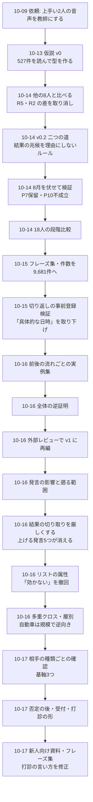

# 営業通話分析の経緯 v1

作成日: 2026-10-17 / 対象範囲: 2026-10-09 の最初の依頼から 2026-10-17 の新人向け資料までの全作業。何をどの順で調べ、何が分かり、何が覆り、その後に何が分かったかを残す。

- 10-09〜10-12 の作業はコミットしておらず、会話の記録から組み立て直した。
- 人名は社内の担当者の姓だけにした。顧客の名前は載せない。
- 数字は各時点の資料のもの。後で直した数字は「覆されたこと」に並べた。

## 1. 問いの移り変わり

| 時期 | 問い | 主な材料 |
|---|---|---|
| 10-09〜10-12 | アポが上手い2人(佐藤・斎藤)の音声から、アポの取り方を教師あり学習で取り出せるか | アポ直前の通話 298件と、取れなかった通話 596件 |
| 10-13〜10-14 | 取れた通話と取れなかった通話は、どの発言で分かれるか。教師の2人と他の営業は何が違うか | 527件 → 18人の段階比較 |
| 10-14〜10-16 | 切り返し・冒頭・今かける理由のフレーズ集と、前後の流れごとの実例集 | 1,368件 → 9,681件(アポ 621件) |
| 10-16 | 外部レビューを受けて、監査済みの知識・行動仮説・通話分類に分け直す | 同上 |
| 10-16 | どんな発言が出ればアポ率が動くか。その発言は何ターン遡れば決まるか | 9,681件 |
| 10-16 | リストの属性(規模・業界・地域・時間帯・役職)はどれだけ効くか | 全架電 15,467本 |
| 10-16〜10-17 | どんな相手にも通じる基軸は何か。新人に渡せる形にする | 9,681件 + 全架電 |

## 2. 段階ごとの経緯

### 0. 依頼とデータの用意(10-09〜10-12、コミットなし)

**きっかけ** 最初の依頼(10-09)の要旨: 「Zoom Phone の音声から、新規営業のアポ音声を分析したい。10月の佐藤さんと斎藤さんがアポが上手いので、教師あり学習の教師にする。アポ確定に移った日の少し前の、同じ番号への70秒以上の通話を拾って、まず何件か教えて」。その後、「9月まで広げる」「まず取れた・取れないで教師あり学習をして分類問題を解き、その後ナレッジ化する」「6月まで広げて300件あればいい」と続いた。

**やったこと**
- Zoom Phone の通話履歴と HubSpot のステージ入りの時刻を照らし合わせた。条件は、ステージ入りの前3営業日以内・同じ番号・最後につながった通話。
- 6〜10月で取れた通話 298件を集めた。取れなかった通話は 5,102件から担当者×月で層を分け、596件を抜いた。
- 文字起こしは Zoom の API から取った。外部の生成AIへの送信は止められた。
- 文字の並びで8群に分けた。

**分かったこと** 群は「担当者×通話の種類」(不在・アポ後のフォロー・保留音など)で分かれ、アポの特徴は出なかった。

**直したこと**
- 合意なしに判定項目を足したところ、「基準は個別具体を要件定義してから」と指摘を受けた。
- 不在の通話はアポの音声として扱わないことにした。

### 1. 仮説 v0(10-13、`208f73fa`)

**やったこと**
- 文字起こしのある 1,231件を読んで分類した(取れた 297・取れなかった 248 ほか)。
- 断られ方を型に分けた。日時の了承の前と後を分けて比べた。

**分かったこと**
- 先方の第一声で取れた割合が分かれる: 了承 96%、日程の話 65%、質問 41%、需要の断り 12%。
- 仮説 R1〜R7 を立てた(職種名を出さない、今かける理由、日程の断りに別の日時、など)。

**覆されたこと**
- 「アポの電話 827件」は、案件1件あたり14日以内の電話を複数数えたもので、電話の件数でもアポ率でもなかった(「矛盾している」との指摘から判明)。抜き出した中の割合はアポ率ではないと明記した。
- 取れた側の需要の断りは、多くが日時の了承の後に出ていた。了承の前だけで比べ直した。

### 2. 527件の全件判定と、現場から出た要素(10-13、`9b62e8f2`・`030f4557`)

**分かったこと** R1〜R7 で、担当者を入れ替えても AUC 0.88〜0.92 が出た。

**覆されたこと**
- R3・R5 は「打診し直したか」を含み、結果と重なるので高く出ていた。重ならない R1・R2 だけでは AUC 0.6 強。
- R6(同じ断りが3回続いたら時期を聞く)は、その通話では取れない(22件中1件)。「次回への布石」として別枠にした。
- 現場の意見で R8〜R10(テンション・リアクション・噛み合い)を足した。リアクションは文字からは差が出なかった。

### 3. 他の営業8人との比較(10-14、`c4871e50`)

**やったこと** 8人の 253件を判定した。アポは本人の電話から数えた(外部アポインターの分を除くため)。

**覆されたこと**
- **R5(需要の断りへの返し)の差を取り消した。** 教師 28% 対 8人 8% は比率の偏りで、断られた通話の中で比べると 4% 対 6% と差がなかった。
- **R2(今かける理由)の差は、佐藤一人によるものだった。**
- R1・R10 は、教師と他の8人を分けなかった。

**残った差** 同じ「日程の話」から始まっても、8人は教師の約半分しか取れていない(27% 対 15%)。

### 4. v0.2 二つの道と「結果の兆候」ルール(10-14、`ce4dffe0`・`1e87494f`)

**きっかけ** 「日付と時刻を組にして出す」(H3)は、先方の手がかりを回収しているだけで「順番が前後していないか」と指摘を受けた。「取った後に必ずするヒアリングが理由かどうかは別問題」とも。

**覆されたこと**
- H3 を取り下げた。H2・H6 も通話を分ける力がなかった。
- 「先方の状態×打ち手」の枠組みは後知恵になるため不合格にした。

**決めたルール** 原因は、先方が最初に手がかりを出した時点(分かれ目)より前だけで測る。確定・復唱・メール確認は結果の兆候として扱い、理由にしない。

**分かったこと**
- 手がかりがあれば、8人も 78〜88% 回収できる。差は、手がかりを引き出す力(斎藤 71% 対 8人 45%)と、手がかりがなくても日時を出し続けるか(8人は 78% がやめる)にあった。
- 佐藤型(先回りして繰り返す)と斎藤型(日付だけを問いかけ、先方の都合を先方の口から言わせる)に分かれた。

### 5. 8月を伏せた検証(10-14、`80bfc557` 事前登録 → `465ee68b` 結果)

**やったこと** 担当者を伏せた8月の 219件で、予測 P1〜P10 を事前に固定してから確かめた。

**結果**
- P1〜P6・P8・P9 は成立した。
- **P7(佐藤型を2回以上)は保留。** 手がかりのない通話では、何回出しても0件だった。
- **P10(斎藤型の点数で人を並べる)は不成立。** 佐藤は点数が最下位で、アポ率は最上位だった。「山口は打診の回数が少ないからダメ、という話だったのでは」という指摘から、点数が「打診まで行くか」の段階を無視していると分かった。

### 6. 18人の段階比較と需要の断り(10-14、`d4fbbb38`〜`53ce9bcb`)

**分かったこと**
- 手がかりを引き出す力が、人ごとのアポ率と相関した(0.58)。
- 現場の知見として、次の3点を記録した。
  - 求人を出したまま「充足」と言う会社が多い(潜在需要がある)。
  - アポの段階で需要を突くと断られる。
  - 主流は「ぬるっと日程を切る」やり方。
- 需要の断りから取れた11件の骨格: 受け止める → 欠けているところを探す → 会う理由を作り直す → 日程を出し直す。

**残した課題** 本当に需要がないのか、断り文句なのかを見分ける方法。

### 7. フレーズ集と件数の拡大(10-14〜10-15、`34d264af`)

**きっかけ** 「具体的にすると NG を食らい、抽象的すぎると怪しまれる。そのちょうど良いフレーズ集を」「数を担保しないと結果がぶれる」。

**やったこと** 対象を 15,468本 → 担当者と話せた 9,681件(アポ 621件)まで広げた。

**覆されたこと**
- 少ないデータで勧めた「件名を出すなら『中途の採用』まで」は、大きいデータで覆った。
- 「覚えていらっしゃいますか」は「差がない」としていたが、件数を増やすと差が出た。この点は段階13でさらに変わった。

### 8. 親しさ・声・切り返し(10-15、`27557530`)

**分かったこと**
- 文字から見た親しさ(既存感)は、人ごとのアポ率と順位相関 0.68。
- 声は人ごとの癖として出ていて、通話1本ごとには変わらない。
- 上位と下位の差の約2/3は、第一声の後に開いていた。

**後で取り消したこと** 「日程の話の後は、具体的な日時のほうが決まる」(段階9で逆向きと分かった)。

### 9. 切り返しの事前登録検証と、打診回数の目安(10-15、`e489e2a8`〜`8a61a88c`)

**結果(900件、予測は事前に固定)**
- **C1「具体的な日時は日付だけより決まる」は逆向きだった**(12.4% 対 15.2%)。
- C2・C4〜C6 も不成立で、「具体的な日時」「何の件?への答え方」を一般的な助言から外した。

**指摘を受けて変えたこと**
- 「需要の断りの後に採用状況を聞いて取れないのは、熱さがないと判断して打診をやめた可能性もある」→ 意図的な選り分けの可能性として追記した(`b73cf327`)。
- 「日程を切ることでしかアポにならないのだから当たり前」→ 結果ではなく、先方の次の返事で比べる方式に変えた(`09de7178`)。
- 「最低何回は打診する、という基準が欲しい」→ 回数ごとの前向きな返事の割合を測った。
  - 2〜4回目の前向きな返事は 15〜20%。
  - 70% の通話は4回目に届く前に打診をやめている。
  - 事前登録した検証で成立した(`8a61a88c`)。
  - ただし、4回目まで続いた通話は、営業が続けると判断した通話に偏る。

### 10. 前後の流れごとの実例集(10-15〜10-16、`45359864`〜`bf16ecfe`)

**きっかけ** 「良い例だけでなく悪い例も、前後の因果関係を含めたパッケージで。そうでないと局所的に真似して失敗する」。

**やったこと** 「何の件?」621件と、冒頭・今かける理由・切り返しの 2,004件を、前後の流れごとの実例集にした。

### 11. 全体の逆証明と月ごとの分類テスト(10-16、`d30d6cb9`)

**覆されたこと(取り下げ)**
- 斎藤型の手順4「ダメな日を言わせる」: 次の返事はむしろ低かった。
- 「今日・明日の打診」: 教師では逆向きだった。
- 「思い出せない」と言われたら説明せずに日時へ進む: 7件しかなかった。

**直したこと** 名前の置き換え漏れを直し、載せた例を監査した(479件中20件を差し替え)。

**分類テストの結果**
- 全文で AUC 0.97〜0.99。ただし効いていたのは、メール・リンクなど結果の兆候だった。
- 結果より前の営業の発言だけでは 0.68〜0.72。

### 12. 外部レビューと v1 への再編(10-16、`615128fd`・`f88c4f38`)

**レビューの指摘(要修正 12件)**
- 「打診前」の切り位置から未来の情報が漏れていた。677件で「打診前」が全文と同じだった。
- 有意差がないものを「差が小さい」と書いていた。
- 匿名化に漏れがあった。
- 比較する群が重なっていた。
- 時期で分けた検証をしていなかった。

**再編したこと**
- 監査済みの知識(8例)・行動仮説・通話分類の3つに分けた。
- 担当者と月をそろえると、比べられる区画はほとんど残らなかった。そのため、効果の主張は保留にした。
- 段階11で「頑健」としていた「日程の断りに日時へ戻す 対 採用状況を聞く」は、192件 対 6件で判定できなくなった。
- 分類モデルは、過去の月で学習して後の月で試すやり方で、打診の前の発言だけでは AUC 0.60〜0.68 に下がった。
- 「予測の性能と、営業の改善に役立つ知識は別物」という整理をした。

### 13. 発言の影響と遡る範囲(10-16、`f798eb71`)

**きっかけ** 「どんな発言が出ればアポにインパクトするのか。その発言はトークをどこまで遡れば再現できるのか」。リストの属性は使わず、トークだけで見る。

**やったこと**
- 9,681件の発言を、意味の近いもので型に分けた(営業 80型・先方 60型、日本語の文の埋め込みとクラスタリング)。
- 同じ担当者・同じ段階・通話の中の同じ位置どうしで、アポ率の差を比べた。6〜8月と9〜10月で同じ向きのものだけを残した。

**分かったこと(初版)**
- 上げる側: 先方が時間帯の話をする +25pt。先方が「その日は予定がある」と答える +19pt。営業が午前・午後の時刻を挙げる +18pt。
- 分かれ目1: 「予定がある」と言われて別の日を出し直すと、引き下がった場合より +20pt。
- 分かれ目2: 打診の前に「募集していないですか」と聞くと −6〜−8pt。
- 遡る範囲: 先方の返事は営業の直前の1〜2ターンでほぼ決まる。打診まで行くかは3ターン前まで見れば足りる。

### 14. 切り取りを厳しくし、区間と型の中身を確かめた(10-16、`864df570`)

**覆されたこと**
- **上げる発言のうち5つが消えた。**
  - 対象: 欠員か増員かを聞く(+6pt)、職種を聞く(+6pt)、人手不足の話(+5pt)、決める人を聞く(+5pt)、媒体を使っている(+5pt)。
  - 結果の切り取り(アポが決まった時点で通話を切る位置)に、Zoom・リンク・メールアドレス・アンケートと、「先方が日付と時刻をそろえて言った発言」を足した。
  - するとアポ後まで見ていた通話が 95件から17件に減り、5つの差はほぼ0になった。アポが決まった後の聞き取りだったと分かった。
- **「引き下がる」の型に、時期をずらして打診し直す発言が混ざっていた。** それを除くと、出し直しの差は +21pt(引き下がった側は84件でアポ0件)。
- **「お久しぶり/覚えていますか」が打診を増やすような書き方を直した。**
  - 通話単位では、言った通話と言わなかった通話のアポ率は 5.6% 対 5.8%。
  - 過去に通話がある場合も 10.4% 対 10.4% で、差はない。
  - 「日時を出す直前の定位置」にすぎない、と書き換えた。

**確かめたこと**
- 2つの分かれ目に、電話番号ごとに選び直した区間を付けた。出し直し +16pt [+12, +21]、需要の質問 −6pt [−7, −5]。
- 主な24型を各30件読み、結論を支える型の 80〜97% が型の名前どおりだと確かめた。
- 先方の心理から見た解釈(仮説)を4つ書いた。
- 実例を匿名化して16件載せた。
- リストの属性は、トークと混ざらないよう別の資料に分けた。

### 15. リストの属性(10-16、`864df570` → `e6347997`)

**覆されたこと**
- 初版では、話せた通話だけ・照合率 56% で調べ、「会社の属性ではほとんど見分けられない」と書いた。
- 「従業員数とか色々インパクトすると思うけどね」と指摘を受け、全架電 15,467本(照合 84%)で、担当者と月をそろえて測り直した。
- 結果、**従業員数ははっきり効いていた**(10〜99人 3.6% に対し、300〜999人 1.55倍、1000人以上 1.78倍)。「見分けられない」は誤りだった。
- 1本ごとの予測(AUC 0.5前後)と、リストの組み方で全体のアポ率が動くことは別の話で、それを混同していた。

**分かったこと**
- 大きい会社ほど受付で止まりやすいが、つながった後のアポ率がそれ以上に高い。
- 都道府県はほぼ効かない。
- 人事・採用の窓口につながる通話は低い。
- 同じ番号への2回目以降は高い(ただし、頼まれたかけ直しが混ざる)。

### 16. 多重クロス集計と層別(10-16〜10-17、`05a35549`・`fb28de75`・`74b3f2e4`)

**きっかけ** 「多重クロス集計分析を先に挟んで」。続いて「意味が同じものが多分ある(運輸物流は規模が小さいところが多い、など)」「全部入れると潰し合う。業界と従業員数は切り分けて考えないと中途半端な結果になる」。

**覆されたこと**
- 「9時台は高い」は言い過ぎだった。9時台はかけ直しが集まっていて、それをそろえると 1.16倍 [0.89–1.48] に縮み、6〜8月だけでは逆向きになった。
- 「業界が少し効く」は、運輸・物流以外は前後半で入れ替わった。
- 「運輸・物流は小さい会社が多い」はデータでは逆だった。運輸・物流はやや大きい会社寄りで、小さい会社に偏っているのは工事・土木。
- 全項目を1つのモデルに入れた倍率では、自動車・輸送は 1.52倍。
  - 業界と規模を切り分けると、小さい会社(整備工場)は前後半とも他業界の1.5倍以上だった。
  - 300人以上(部品メーカー)は前後半とも約3分の1だった。
  - 1.52倍は、この2つを混ぜた中途半端な値だった。指摘のとおりで、問題は打ち消し合いではなく、業界ごとの違いが平均されて見えなくなることだった。

**分かったこと** 規模の効果は、ほかの属性を同時にそろえても変わらなかった(300人以上 1.67倍、前後半とも同じ)。

### 17. どんな相手でも通じる基軸(10-17、`d2bbe42f`)

**きっかけ** 「トーク側を掘りたい。成約率はリストコントロールでなんとかする。どんな相手でも通じる基軸になる方針を」。

**分かったこと**
- 規模・業界・役職・何回目の電話か・時間帯・期間・担当者のどれで分けても、次の3つは向きが変わらなかった。
  - 需要を聞かない: −6pt を避ける。13人全員で同じ向き。
  - 「忙しい」で引かない: +16pt。
  - 早く日程を出す: +4pt。18人中16人で同じ向き。
- 「中途採用の件で」と切り出す効果は、相手によって向きが変わったので、基軸から外した。
- 打診に時刻まで入れても上がらなかった(日付だけより −2.7pt)。段階9の C1 の結果と一致する。

### 18. 否定の後・受付・打診の形(10-17、`f5bfb72b`)

**覆されたこと**
- **「需要を否定された直後に日程を打診すると +23pt」は誤りだった。**
  - 先方の発言の型に、「大丈夫ですよ」(時間は空いている)や「その日は埋まっている」(予定の話)が混ざっていた。
  - 発言の文字で需要の否定を確かめた 1,650件では、どう返してもアポ率は全体で 1.1%(18件)。
  - 結論は「否定の後の切り返しでは取り返せない。否定を引き出さないことが大事」に変わった。

**分かったこと**
- 受付では、担当者の名前で呼ぶと担当者につながる率が +13pt、前回の件を出すと +11pt。アポ率までの差ははっきりしない。
- 受付に用件を聞かれたときの答え方(前回の続き/採用の件)では差がない。
- 打診に時刻まで入れても、先方の乗り方は変わらない。
- 先方に「ご都合のよい日は」と選んでもらう聞き方は大きく出たが、24件しかない。

### 19. 新人向け資料とフレーズ集(10-17、`9d61c11e`・`c3ac83c9`)

**きっかけ** 「営業の初心者向けに、うまくいく方法と悪い方法を、フローチャートやトークスクリプトで。HTML がいい」。続いて「キーワード的なフレーズがたくさんあるはず。確度が低くてもいい」。

**やったこと**
- 基本の4つ・フローチャート・良い例と悪い例・場面ごとのスクリプトを HTML にまとめた。
- 発言を単語の並びに分けて、場面ごとにアポ率との関係を調べた。

**覆されたこと**
- **新人向け資料のスクリプトに、低い言い方を入れていた。**
  - 打診を「採用サービスの中身をお伝えしたく」としていたが、この言い方はアポ率 −7pt(打診の約半分の 2,471件がこの言い方)。
  - 「お打ち合わせ」は +8.6pt だったので、スクリプトを直した。
- 通話全体で言い回しを数えると、日程が決まった後の言葉(「何名で」「40分ぐらい」)と、電話を切る挨拶が上位を占めた。そこで、場面(冒頭・打診・断りの直後)に分けて数え直した。
- **「先方に選んでもらう」は、場面によっては逆効果だった。** 「忙しい」の後に「いつ頃なら」と聞くと、具体的な日を出すより −16pt。段階4の斎藤型「先方の都合を先方の口から言わせる」も、段階11で一部を取り下げている。選んでもらうのは、日付をこちらが出した上での時刻に限る、とした。

## 3. 覆されたこと・縮んだことの一覧

| 時期 | 当初の主張 | 何で分かったか | 今の扱い |
|---|---|---|---|
| 10-13 | アポの電話 827件 | 案件ごとに14日以内の電話を複数数えていた | 件数を数え直し、抜き出した中の割合はアポ率ではないと明記 |
| 10-13 | 取れた側は需要の断りをうまく返す | 断りの多くは日時の了承の後だった | 了承前だけで比べる |
| 10-13 | R1〜R7 で AUC 0.88〜0.92 | R3・R5 が結果と重なっていた | 重ならない項目では 0.6 強 |
| 10-14 | R5 で教師と他の営業が分かれる | 比率の偏り。断られた通話の中では差なし | 取り消し |
| 10-14 | R2(今かける理由)が効く | 佐藤一人の差だった | 人の癖として扱う |
| 10-14 | 日付と時刻を組にして出す(H3) | 先方の手がかりを回収しているだけ | 取り下げ。結果の兆候ルールを作った |
| 10-14 | 斎藤型の点数で人を並べられる | 8月を伏せた検証で不成立(相関 −0.05) | 不成立 |
| 10-14 | 件名を出すなら「中途の採用」まで | 件数を増やすと覆った | 撤回 |
| 10-15 | 具体的な日時のほうが決まる | 事前登録した検証で逆向き | 取り下げ。10-17 の確認とも一致 |
| 10-16 | 斎藤型「ダメな日を言わせる」・今日明日の打診 | 逆証明で次の返事がむしろ低い | 取り下げ |
| 10-16 | 日程の断りに日時へ戻すのが頑健 | 外部レビューの後、比べられる件数が 192 対 6 | 判定できない |
| 10-16 | 分類 AUC 0.97〜0.99 | 結果の兆候が効いていた。時期で分けると打診前は 0.60〜0.68 | 予測と改善の知識は別物 |
| 10-16 | 欠員・職種・決める人を聞く、などで +5〜+6pt | 切り取りを厳しくすると消えた | アポ後の聞き取りだった |
| 10-16 | 「お久しぶり/覚えていますか」が効く | 通話単位では 5.6% 対 5.8% | 定位置にすぎない |
| 10-16 | 会社の属性ではほとんど見分けられない | 全架電で測り直すと、規模は 1.5〜1.8倍 | 誤り。予測の良さと全体への効き方を混同していた |
| 10-16 | 9時台は高い | かけ直しの偏りをそろえると縮み、前半は逆向き | 確かとは言えない |
| 10-16 | 業界は少し効く | 前後半で入れ替わる | 安定しているのは運輸・物流だけ |
| 10-17 | 自動車・輸送は 1.52倍 | 規模で分けると、小さい会社は高く、大きい会社は低い | 業界は規模との組で見る |
| 10-17 | 需要を否定された直後に打診すると +23pt | 型に予定の話が混ざっていた。文字で確かめると 1.1% | 取り返せない。否定を引き出さない |
| 10-17 | 打診は「採用サービスの中身をお伝えしたく」(新人向け資料) | 言い回しの集計で −7pt | 「お打ち合わせ」に修正 |
| 10-17 | 先方に「いつ頃なら」と選んでもらう | 「忙しい」の後では −16pt | 日付はこちらが出す |

## 4. 今の時点で残っている結論

**トーク(どんな相手にも通じる基軸)**
1. 打診の前に需要を聞かない。
2. 名乗ってから2〜3回のやり取りで、日付(週・曜日)を出す。打診は「お打ち合わせ」で頼む。
3. 「忙しい」と言われたら、こちらから別の日を出し直す。
4. 受付では担当者の名前で呼ぶ(そのために名前を記録する)。

**リスト(経営の戦略)**
- 規模が大きいほどアポ率が高い。
- 業界は規模との組で見る(自動車は規模で逆向き)。
- 都道府県・時間帯は決め手にならない。

**予測と知識**
- 通話全体の分類はよく当たるが、効いているのは結果の兆候。
- 結果より前の発言だけでは AUC 0.6台で、知識としては比べた差を使う。

## 5. 作業中に決めたルール(ユーザーの指示)

| ルール | 決めた時期 |
|---|---|
| 判定の基準は、実装の前に定義を合意する | 10-09 |
| 不在の通話はアポの音声として扱わない | 10-09 |
| 「前回〇〇の件で」は既存感で、初めての相手でも基本形。文面だけで再接触と判定しない | 10-13 |
| トーク(メンバーの戦術)と、熱いアポのリスト作り(経営の戦略)を分ける | 10-13 |
| 結果の兆候(確定・復唱・メール確認)を理由にしない。原因は分かれ目より前で測る | 10-14 |
| 段階の順番で見る。まず早く日程を切る。その先は正解が複数ある | 10-14 |
| 担当者を伏せ、別の期間で、予測を固定してから確かめる | 10-14 |
| 件数を増やす(少ないと結果がぶれる) | 10-14 |
| アポは本人の電話から数える(外部アポインターの分を混ぜない) | 10-14 |
| 脈の見立てより、打診の回数の基準で決める | 10-15 |
| 打診の効果はアポではなく、先方の次の返事で測る | 10-15 |
| 実例はパッケージで: 前後の流れ、良い例と同じ型の悪い例、要約と原文の両方 | 10-15 |
| テーブルデータ(会社の属性)は使わず、トークだけでどこまでできるかを見る。リストは別の資料にする | 10-16 |

## 6. まだ確かめていないこと

| 項目 | 状況 |
|---|---|
| 効果の証明 | すべて記録の比較。基軸の4つと「お打ち合わせ」の言い方は、一部の担当者で話し方を決めて試さないと因果は分からない |
| 打診の回数の基準 | 4回までは前向きな返事が続く(10-15 の事前登録検証)。新人向け資料は「最低1回」としており、回数の基準は決めていない |
| 遡る範囲 | 結果の切り取りを厳しくした後、測り直していない |
| 需要の否定が本物か断り文句か | 見分ける方法は候補だけ |
| アポの後 | 商談化・受注の率は見ていない(リストの熱さの側) |
| 受付で名前を呼ぶ効果 | 名前が分かる相手は、もともと関係がある相手。その差を除き切れていない |

## 関連

- [README](README.md)
- [発言の影響と遡る範囲 v1](utterance-impact-v1.md)
- [リストの属性とアポ率 v1](list-attributes-v1.md)
- [アポ取りトークの基本 v1](talk-guide-v1.html)
- [行動仮説検証レポート v1](action-hypotheses-v1.md) / [通話分類モデル v1](call-classification-v1.md)
