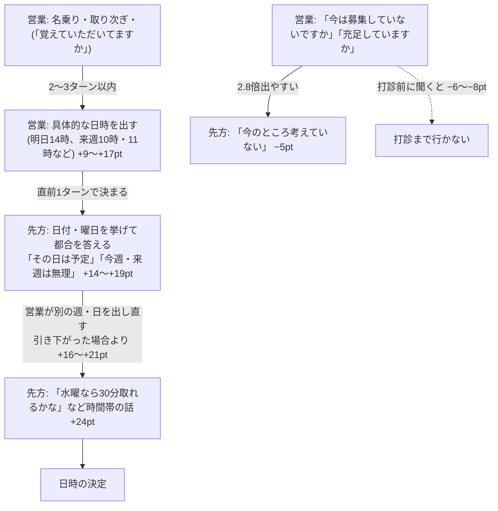

# 発言の影響と遡る範囲 v1

作成日: 2026-10-16 / 対象範囲: 2026年6～10月の取得済み通話 9,681件(アポ 621件)。トークの文字起こしだけを使い、リストの属性(業種・規模など)は使っていない。リストの属性は[リストの属性とアポ率 v1](list-attributes-v1.md)に分けた。

## 問い

1. どんな発言が出るとアポ率が動くか
2. その発言は、通話をどこまで遡れば再現できるか(何ターン前の発言で決まるか)

## 結論

アポ率を動かすのは「日程のやり取りに入れるか」と「入った後に引かないか」。

## 重要な発言

差は、同じ担当者・同じ段階(打診前/打診/打診後)・通話の中の同じくらいの位置の通話どうしで比べたアポ率の差(ポイント)。6～8月と9～10月の両方で同じ向きに出たものだけを載せた。

**上げる側**

| 発言 | アポ率の差 | 6〜8月 / 9〜10月 |
|---|---:|---|
| 先方: 時間帯や取れる時間の話をする | +24pt | +20 / +27 |
| 先方: 日付・曜日を挙げて都合を答える(「その日は予定がある」など) | +19pt | +16 / +21 |
| 営業: 午前・午後の具体的な時刻を挙げる | +17pt | +12 / +22 |
| 先方: 今週・来週の予定を答える(「都合がつかない」など) | +14pt | +12 / +15 |
| 営業: 明日・今週などの日時を挙げる | +12pt | +11 / +13 |
| 営業: 忙しいと言われて、別の週・日を提案する | +11pt | +11 / +12 |
| 営業: 「来週はいかがですか」と聞く | +9pt | +8 / +11 |
| 営業: 面談・オンラインでお話ししたいと言う | +6pt | +5 / +6 |

**下げる側**

| 発言 | アポ率の差 | 6〜8月 / 9〜10月 |
|---|---:|---|
| 営業: 「今は募集をしていないですか」と確かめる | −6pt | −7 / −6 |
| 先方: 「今は募集していない」と言う | −5pt | −5 / −6 |
| 先方: 「今のところ考えていない」と言う | −5pt | −5 / −5 |
| 営業: 「今は充足していますか」と確かめる | −5pt | −4 / −6 |
| 先方: 営業を断る・見送る・不要と言う | −5pt | −4 / −5 |
| 営業: 「中途採用の件でお電話しました」と切り出す | −4pt | −2 / −5 |
| 先方: 「申し訳ない」と詫びて断る | −4pt | −3 / −4 |
| 先方: 「何の件ですか」と聞く | −3pt | −2 / −4 |

日時が決まった後の手続き(メールアドレス・Zoomのリンク・アンケート・リマインドの案内・復唱など)と、電話を切る挨拶は、結果の兆候なので原因候補から除いた。

### 切り取りを厳しくして消えたもの

初版では、次の5つもアポ率を上げる発言に入れていた。

| 発言 | 初版 | 切り取りを厳しくした後 |
|---|---:|---:|
| 営業: 欠員か増員かを聞く | +6pt | +0.5pt |
| 営業: 職種を聞く | +6pt | +2pt |
| 先方: 人手不足の話をする | +5pt | +0.3pt |
| 営業: 決める人は誰かを聞く | +5pt | +0.5pt |
| 先方: 媒体や紹介を使っていると言う | +5pt | +1pt |

- 切り取りの条件に、Zoom・リンク・リマインド・メールアドレス・アンケート・「入れといて」と、先方が日付と時刻をそろえて言った発言を足した。
- その結果、アポが決まった後の部分まで見ていた通話は、95件から17件に減った。
- 上の5つの差がほぼ消えたので、これらは「アポが決まった後の聞き取り」だったと見られる。
- 日時の前のヒアリングがアポ率を上げる、という根拠にはならない。

## はっきり差が出た2つの分かれ目

### 1. 「予定がある」「今週・来週は無理」と言われた直後の返し方

| 先方の発言 | 営業の返し | 件数 | アポ | アポ率 |
|---|---|---:|---:|---:|
| 予定・忙しい・休み(広め) | 別の日を出し直す | 1,313 | 240 | 18.3% |
| 同上 | 引き下がる | 179 | 9 | 5.0% |
| 「その日は予定」「今週・来週は無理」だけ | 別の日を出し直す | 759 | 205 | 27.0% |
| 同上 | 引き下がる | 52 | 5 | 9.6% |

同じ担当者どうしの差と、その95%区間は次のとおり。95%区間は、同じ電話番号の通話をまとめて2,000回選び直して出した。

| 比べ方 | 差 | 95%区間 |
|---|---:|---|
| 広め | +16pt | +12〜+21 |
| 「予定」「今週・来週は無理」だけ | +19pt | +10〜+27 |
| それまで先方が一度も否定していない通話だけ | +19pt | +14〜+24 |
| 「引き下がる」から時期の話の型を外した場合 | +21pt | +17〜+25 |

- 6〜8月は+12pt、9〜10月は+19ptで、どちらの期間でも出ている。
- 引き下がった側は、それまでに先方の否定を聞いていた割合が高い(39%、出し直した側は21%)。つまり、引き下がった側には固い断りの相手が多い。
- ただし、否定がなかった通話だけに絞っても差は残った。
- 「引き下がる」に入れていた型の1つは、先方が時期を言う発言が混ざった型だった(下の「型の中身の確認」)。これを外すと、引き下がった84件でアポは0件だった。
- 時期をずらして聞き直す返しは、引き下がりではなく出し直しの一種と見る([実例](utterance-impact-examples-v1.md)の例8)。

### 2. 打診の前に「募集していないですか」「充足していますか」と聞くか

| 打診前の質問 | 件数 | アポ | アポ率 |
|---|---:|---:|---:|
| 聞いた | 913 | 10 | 1.1% |
| 聞かなかった | 8,768 | 611 | 7.0% |
| 聞いた(先方がまだ否定していない段階) | 443 | 7 | 1.6% |
| 聞かなかった(同じ段階) | 5,795 | 492 | 8.5% |

- 同じ担当者どうしの差は−6pt(95%区間 −7〜−5)。先方がまだ否定していない段階に絞ると−8pt(−9〜−6)。
- 6〜8月と9〜10月はどちらも約−6ptだった。
- 質問の直後には「今のところ考えていない」が2.8倍出やすい。アポ段階で需要を突くと断りを引き出す、という以前の見立てと一致する。

## どこまで遡ればよいか

| 発言 | 見れば足りる範囲 | 根拠 |
|---|---|---|
| 先方の日程の話・断り | 直前の1〜2ターン | それより前を足しても予測が良くならない(むしろ悪化) |
| 営業が日時の打診まで行くか | 3ターン前まで | 予測の良さ(AUC)が 0.73 → 0.81 まで上がり、そこで止まる |

この節の数字は、切り取りを厳しくする前の集計。分かれ目の比較には影響が小さいことを確かめたが、遡る範囲は測り直していない。

先方の発言は、営業の直前の一言でほぼ決まる。

| 先方の発言 | その直前の営業の発言(出やすさ) |
|---|---|
| 時間帯の話 | 午後の時刻を挙げる(13倍)、午前の時刻(6倍)、明日・今週の日付(5倍) |
| 日付・曜日を挙げて都合を答える | 別の週の再提案・時刻・日付を挙げる(4〜5倍) |
| 今週・来週の予定を答える | 「来週はいかがですか」(10倍) |
| 「考えていない」 | 「募集していないですか」(2.8倍)、他の有料媒体を使っているか(2.6倍) |

打診までの流れ:

1. 名乗る
2. 「お久しぶりです/覚えていただいてますか」と言う(打診の2ターン前にこれがあることが2〜3.5倍多い)
3. 先方が「はい」と受ける、または取り次がれる(3ターン前の取り次ぎで打診が2倍出やすい)
4. すぐ日時を出す

補足:
- 「覚えていますか」は、打診の直前に置かれることが多いだけで、言った通話のほうが打診やアポが多いわけではない。通話単位で比べると、打診率は言った通話51%・言わない通話58%、アポ率は5.6%と5.8%でほぼ同じだった。この言葉は「日時を出す直前の定位置」であり、それ自体の効果は確認できていない。
- 同じ番号への2回目以降の通話は、言葉の有無にかかわらずアポ率が10.4%で、初回の5.8%より高い(リストの側の話。[リストの属性とアポ率 v1](list-attributes-v1.md))。
- 「覚えていない」と言われた直後でも、打診は3.3倍出やすい。説明に入らず日時を出している。
- 「今は募集していない」「充足している」「検討中」と言われた直後は、打診まで行くことがほとんどない(0.02〜0.09倍)。

## 先方の心理から見た解釈(仮説)

以下は数字の読み方の仮説で、測ったものではない。

**1. 具体的な日時は、問いを「会うか」から「いつ会うか」に変える**
- 「お話しできませんか」は、会うかどうかの判断を先方に預ける。
- 「来週水曜の10時は」と聞くと、先方は手帳を見て答える側に回る。
- 「その日は予定がある」は、会う前提で日程を答えている。断りではなく、乗ってきた合図と読める。
- 先方の日程の返事が営業の直前の一言で決まる(1〜2ターン)のは、先方が問いの形に沿って答えているためと見られる。

**2. 日程を理由にした断りには、角を立てない断りが混ざる**
- 予定を理由にすれば、相手を否定せずに断れる。
- 別の日を出し直すと、本当に都合だけの人は乗ってくる。日程を口実にしていた人は、理由を変えて断る([実例](utterance-impact-examples-v1.md)の例4「出張」→「急に休みが多い」、例5「県外とはやっていない」)。
- 出し直しは、この2つを見分ける問いにもなる。2回目の返事で理由が変わったら、本当の断りと見る。
- 1回で引くと、見分けないまま両方を失う。

**3. 「募集していないですか」は、先方に「いいえ」の出口を渡す**
- 答えやすい「いいえ(していない)」を先方に言わせる。
- 一度「必要ない」と口にすると、その後で言葉を変えにくい(言ったことと行動をそろえたくなる)。
- 求人を出したまま採用が止まっている先は多い。需要の有無を先方の口で判定させると、潜在需要を自分から閉じてしまう。
- 例外は[実例](utterance-impact-examples-v1.md)の例12。先方の状況(一人で応募者対応)を言い当てた後なら、「どこを解決したいか」につながった。

**4. 「覚えていますか」は既存の関係の枠を作る**
- 初回でも「前回〇〇の件で」と入るのが基本形で、関係がすでにある前提で話が進む。
- 「覚えていない」と言われても、先方は覚えていないことに少し引け目を感じる。説明を求めるより、流れに乗りやすいと見られる。
- 説明に入ると「何の件ですか」(−3pt)から営業電話と判定され、断りの型に移りやすい。
- ただし、通話単位ではこの言葉を言った通話のアポ率は高くなかった(5.6% と 5.8%)。効いているのは言葉そのものより、その直後に日時を出す流れのほうと見られる。

## 型の中身の確認(抜き取り)

主な24型について、各30件の発言を読み、型の名前に合うかを確かめた。

| 合う+近いの割合 | 型 |
|---|---|
| 90%以上 | 時間帯の話・午前/午後の時刻・明日今週の日時・「今は募集していない」・「考えていない」・「何の件ですか」・「お久しぶり、覚えていますか」・「覚えていない」・引き下がりの3型 など |
| 80〜89% | 今週来週の予定・別の週の提案・「来週は」・面談のお願い・「募集していないですか」・「充足していますか」・営業を断る |
| 77% | 日付・曜日を挙げて都合を答える(はっきり「予定がある」と言うのは30件中7件。名前を直した) |
| 60% | 「必要なら連絡する」(連絡・資料送付の要望が多い。結論からは外した) |
| 53% | 「時期を確かめて引き下がる」(先方が時期を言う発言が混ざる。分かれ目1の「引き下がる」から外した比較を足した) |

- 日程の型では、営業の打診と先方の返事が一部混ざっていた。どちらも日程の話という点では同じ働き。
- 結論を支える型(日時を挙げる・時間帯の話・募集の確認・考えていない)は、どれも80〜97%が名前どおりだった。

## どんな相手でも通じるか(相手の種類ごとの確認)

トークの方針を、リストの組み方に関係なく使える基軸にできるかを確かめた。発言の効果を、相手の会社の規模・業界・窓口の役職・何回目の電話か・時間帯・期間・担当者で分け、それぞれの中で同じ担当者どうしを比べた。区間は電話番号ごとに選び直して出した。リストの属性は[リストの属性とアポ率 v1](list-attributes-v1.md)と同じ取り方。

| 方針 | 全体 | 規模 | 業界 | 役職 | 回数・時間帯・期間 | 担当者 | 判定 |
|---|---|---|---|---|---|---|---|
| 打診の前に「募集していないですか」「充足していますか」と聞かない | −6.2pt [−7.0, −5.3] を避けられる | 3段とも −5〜−7 | 9業界とも −4〜−9 | 社長・役員だけ −1(51件) | すべて −5〜−11 | 13人全員が同じ向き | **基軸** |
| 忙しいと言われても、別の週・日を出し直す | +16.3pt [+11.8, +20.0] | 1〜99人 +16、100〜299人 +14 | 件数不足(「その他」は +12) | 件数不足 | 1回目 +16、2回目 +18、時間帯 +12〜+22、両期間 +12 / +19 | 引き下がる件数が少なく、比べられたのは1人(+7) | **基軸**(相手の種類ごとの件数は少ない) |
| 早めに日程を打診する(6ターン以内) | +3.6pt [+2.2, +4.8] | 3段とも上げる向き | 自動車の中大手(部品メーカー)だけ −13(39件) | すべて上げる向き | すべて上げる向き。3回目以上は +19 | 18人中16人が上げる向き | **基軸**(差は小さい) |
| 打診に時刻まで入れる(「明日10時・11時」) | 日付だけの打診より −2.7pt [−5.4, −0.2] | — | — | — | 両期間で同じ向き(−3.1 / −2.3) | — | 時刻を足しても上がらない |
| 「中途採用の件で」と切り出す | −1.6pt [−2.8, +0.1] | 向きがばらつく | 自動車の小さい会社は +17、中大手は −11 | 社長・役員 +10、総務 −8 | ばらつく | 6人が上げる、9人が下げる | 基軸にしない |

- **聞かない・引かない・早く出す**の3つは、規模・業界・役職・回数・時間帯・期間・担当者のどれで分けても向きが変わらなかった。リストの組み方と切り離して、全員の方針にできる。
- 募集確認の質問が下げる向きは、2回目以降の電話のほうが大きい(1回目 −5、2回目 −9、3回目以上 −11)。前回の続きで電話しているのに改めて需要を確かめると、話を振り出しに戻す形になる、と見られる。
- 早く打診するのが効かない例外は、自動車の中大手(部品・タイヤのメーカー)だけ。39件と少ないが、リスト側でもこの組はアポ率が低かった。この相手には、手順の前に別の要因(決める人に届いていない等)がある可能性がある。
- 時刻を入れた打診は、日付だけの打診より少し低い。重要な発言の表で「営業が午前・午後の時刻を挙げる」が高かったのは、日程の話をしない場合と比べたため。日程の打診をすること自体が効いていて、時刻まで指定しても上乗せはない。先方に「何時なら空いているか」を言ってもらう形(先方が時間帯の話をすると +24pt)のほうがよい可能性がある。これは仮説で、確かめていない。
- 打診の型の判定は、打診したターンの文字から機械的に拾っている(日付の言葉・「○時」「午前」「午後」)。粗い取り方。

## 基軸の周りの3つの確認

### (a) 「今は募集していない」と言われた後、何と返すか

先方の発言の型だけで拾うと、「大丈夫ですよ」(時間は空いている)や「その日は埋まっている」(予定の話)が混ざった。そのため、文字でも需要の否定(募集・充足・考えていない など)を確かめ、予定の話を除いた 1,650件で見た。

| 直後の営業の返し | 件数 | アポ | アポ率 |
|---|---:|---:|---:|
| 需要を聞き直す | 336 | 2 | 0.6% |
| 受け止める相づち | 335 | 4 | 1.2% |
| 状況を聞く(採用の手段・欠員・窓口など) | 321 | 5 | 1.6% |
| その他 | 258 | 3 | 1.2% |
| 引き下がる | 247 | 0 | 0.0% |
| サービスの説明 | 112 | 1 | 0.9% |
| 日程を打診する | 41 | 3 | 7.3% |

- **需要をはっきり否定された後は、どう返してもほとんど取れない**(全体で 1.1%、通常は 6〜7%)。
- 日程を打診するのが一番高い(引き下がるより +8.6pt [0.0, +18.1])が、41件・アポ3件しかなく、6〜8月は +3.9 と小さい。状況を聞くのは +1.7pt。
- 前の版の集計で「否定の直後に日程を打診すると +23pt」と出たのは、予定の話や「大丈夫ですよ」が混ざっていたため。需要の否定そのものからの立て直しではなかった。
- したがって、基軸1(打診の前に需要を聞かない)は「否定を引き出さない」ことに意味がある。否定を受けた後の切り返しの上手さでは取り返せない。

### (b) 受付を通る言い方

全架電 15,455本の、営業の最初の発言で比べた。比較は同じ担当者・同じ回数(何回目の架電か)どうし。

| 比べたもの | 担当者につながる率 | アポ/架電 | 前後半(つながる率) |
|---|---|---|---|
| 担当者の名前で呼ぶ vs 「採用のご担当者様」で呼ぶ | **+13.3pt** [+2.6, +22.7] | +1.8pt [−0.8, +3.8] | +12.8 / +13.2 |
| 第一声で前回の件を出す vs 出さない | **+10.7pt** [+6.6, +15.6] | +1.7pt [−1.0, +4.8] | +12.8 / +9.5 |
| 受付に用件を聞かれて、前回の続きと答える vs 採用の件と答える | −2.4pt [−12.7, +7.1] | −0.6pt | +0.1 / −3.6 |

- **名前で呼ぶ・前回の件を出すと、担当者につながりやすい。** 回数をそろえても残り、前後半とも同じ大きさ。ただし、名前が分かっている相手はもともと関係ができている相手で、その差を完全には除けていない。
- アポ/架電までの差は小さく、区間が0をまたぐ。受付を通る効果は、つながる率にとどまる。
- 受付に用件を聞かれたときの答え方(前回の続き / 採用の件)では差がない。
- 第一声で「採用の件で」と用件を言う架電は33件しかなく、判断できない。
- 実務では、担当者の名前を HubSpot に残し、次の架電で名前で呼べるようにすることが効く(リスト側の作業)。

### (c) 打診の形

最初に日程を打診した発言の形と、先方の次の返事・アポを比べた(同じ担当者どうし)。

| 打診の形 | 件数 | 先方が日程の話に乗る | 先方が断る | アポ |
|---|---:|---:|---:|---:|
| 日付と時刻(「明日の10時・11時」) | 2,806 | 21% | 36% | 9.2% |
| 日付だけ(「来週どこかで」「水曜は」) | 2,023 | 20% | 39% | 10.5% |
| 時刻だけ | 360 | 19% | 35% | 9.7% |

| 比べたもの | 先方が日程の話に乗る | 先方が断る | アポ |
|---|---|---|---|
| 日付と時刻 vs 日付だけ | −2.0pt [−5.1, +1.3] | +0.4pt | **−2.9pt** [−5.6, −0.1](前後半 −3.4 / −2.3) |
| 候補を2つ以上出す vs 1つ | +1.2pt | −3.6pt [−6.5, +0.1] | +0.2pt |
| 日付だけ + 「ご都合のよい日は」と聞く vs 聞かない | +25pt | −10pt | +32pt(24件しかない) |

- **時刻まで指定しても、先方の乗り方は変わらず、アポは少し下がる。** 打診は日付(週・曜日)までで十分。
- 候補を2つ以上出すと断られる割合が少し下がるが、アポは変わらない。
- 「ご都合のよい日は」と先方に選んでもらう形は大きく出たが、24件しかない。試す候補にとどめる。

## 方法

- 発言の単位: 営業・先方の両方の1ターン。「はい」「ええ」などの相づちは除く。
- 分類: 文の意味を数値にする日本語モデル(cl-nagoya/ruri-v3-130m)を手元の Mac で動かし、意味の近い発言を営業80型・先方60型にまとめた。文字起こしは外部に送っていない。
- 結果の切り取り: 次のいずれかのターンで通話を切り、それより前だけを見た。
  - 結果の兆候(URL・招待・メール送付・Zoom・リンク・リマインド・メールアドレス・アンケート・復唱・「お待ちしております」・「入れといて」など)が最初に出たターン
  - 営業が日時を出した直後に、先方が了承したターン
  - 先方が日付と時刻をそろえて言ったターン
- アポ率の差: 担当者 × 段階 × 通話内の位置で層に分け、各型が初めて出た通話と出なかった通話を層ごとに比べて合算した(Mantel-Haenszel)。6～8月と9～10月に分けて、同じ向きかを確かめた。
- 区間: 同じ電話番号の通話をひとまとまりとして選び直し(2,000回)、2.5%と97.5%の点を取った。
- 遡る範囲: 直前0〜10ターンの型から次の発言を当てるロジスティック回帰を6～8月で学習し、9～10月で評価した(同じ電話番号は学習と評価に分けた)。最良の AUC から0.01以内に入る最短のターン数を「見れば足りる範囲」とした。
- 作業データ・スクリプトは非公開の作業領域(`scratchpad/apo/ml4/`)に置いた。

## 未検証の項目

これは記録の比較で、効くことの証明ではない。

| 項目 | 状況 | 次の確かめ方 |
|---|---|---|
| 出し直しの効果 | 先方の否定の有無で絞っても差が残った。ただし、声の調子など記録に出ない温度差は除けない | 一部の架電で「予定が合わないと言われても、必ずもう1回は別の週を出す」を試す |
| 募集確認の質問の効果 | 否定の前に絞っても差が残った。ただし、断られそうな相手を営業が感じ取って聞いた可能性は除けない | 一部の架電で「打診前に募集の有無を聞かない」を試す |
| 「お久しぶり」から打診への流れ | 確認済み。過去の通話の有無で分けても、言葉の有無でアポ率は変わらなかった(初回 5.6% と 5.8%、2回目以降 10.4% と 10.4%)。ただし6月より前の接点は見ていない | 効果の主張はしない。日時を出す前の定位置として扱う |
| 件数 | 引き下がった側は52〜179件で区間が広い(+10〜+27)。手元にある6〜10月の通話は使い切っている | 11月以降の通話を足して同じ集計をする |
| 相手の種類ごとの確認 | 規模・業界・役職ごとの件数が少なく、特に「出し直す」は引き下がる側が業界・役職ごとに数十件以下 | 11月以降の通話を足し、業界ごとに出し直す |
| 需要の否定の後の切り返し | 否定の後のアポは 18件だけで、どの返しも区間が広い | 件数を足すより、否定を引き出さない方針(基軸1)を試す |
| 受付で名前で呼ぶ効果 | 名前が分かっている相手は関係ができている相手で、その差を除き切れていない | 担当者の名前を記録して次に名前で呼ぶ運用を一部で始め、前後で比べる |
| 時刻を入れた打診 | 日付だけの打診より少し低い(−2.7pt)。先方に時間帯を言ってもらう形がよいかは未確認 | 「来週の水曜か木曜でいかがですか」(時刻は先方に聞く)を一部で試す |
| 遡る範囲 | 切り取りを厳しくした後は測り直していない | 同じ手順で再計算する |

## 関連

- [実例](utterance-impact-examples-v1.md): 分かれ目ごとの匿名化済みの実例(良い例と同じ型の悪い例)
- [リストの属性とアポ率 v1](list-attributes-v1.md): トークとは別の、リストの組み方の話
- [行動仮説検証レポート v1](action-hypotheses-v1.md)
- [通話分類モデル v1](call-classification-v1.md)
