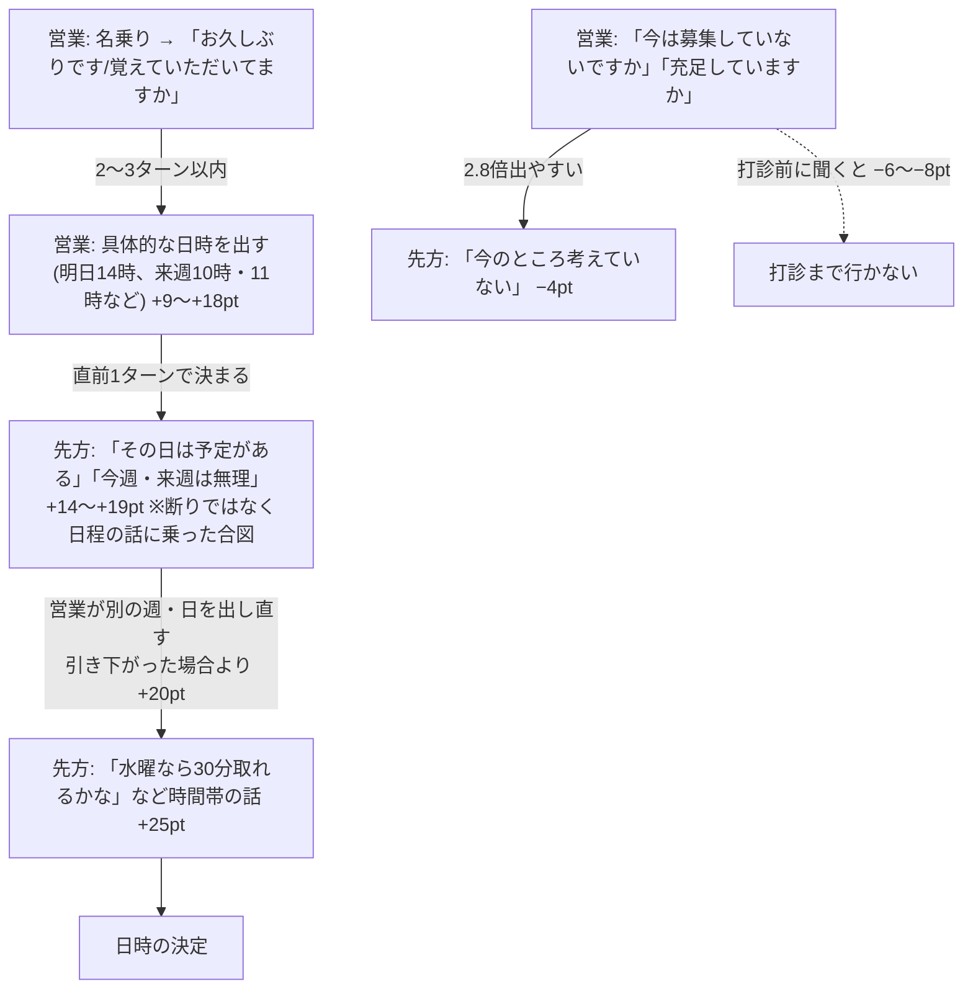

# 発言の影響と遡る範囲 v1

作成日: 2026-10-16 / 対象範囲: 2026年6～10月の取得済み通話 9,681件(アポ 621件)。トークの文字起こしだけを使い、リストの属性(業種・規模など)は使っていない。

## 問い

1. どんな発言が出るとアポ率が動くか
2. その発言は、通話をどこまで遡れば再現できるか(何ターン前の発言で決まるか)

## 結論

アポ率を動かすのは「日程のやり取りに入れるか」と「入った後に引かないか」。

## 重要な発言

差は、同じ担当者・同じ段階(打診前/打診/打診後)・通話の中の同じくらいの位置の通話どうしで比べたアポ率の差(ポイント)。6～8月と9～10月の両方で同じ向きに出たものだけを載せた。

**上げる側**

| 発言 | アポ率の差 | 6〜8月 / 9〜10月 |
|---|---:|---|
| 先方: 時間帯や取れる時間の話をする | +25pt | +21 / +29 |
| 先方: 「その日は予定がある・休み」と言う | +19pt | +17 / +21 |
| 営業: 午前・午後の具体的な時刻を挙げる | +18pt | +13 / +22 |
| 先方: 「今週・来週は都合がつかない」と言う | +14pt | +13 / +15 |
| 営業: 明日・今週の日付を挙げる | +12pt | 両期間とも+ |
| 営業: 忙しいと言われて、別の週・日を提案する | +11pt | +10 / +11 |
| 営業: 「来週はいかがですか」と聞く | +9pt | 両期間とも+ |
| 営業: 欠員か増員かを聞く | +6pt | +7 / +6 |
| 営業: 職種を聞く | +6pt | 両期間とも+ |
| 先方: 人手不足の話をする | +5pt | 両期間とも+ |

**下げる側**

| 発言 | アポ率の差 | 6〜8月 / 9〜10月 |
|---|---:|---|
| 営業: 「今は募集をしていないですか」と確かめる | −6pt | −7 / −6 |
| 営業: 「今は充足していますか」と確かめる | −5pt | −2 / −7 |
| 営業: 「中途採用の件でお電話しました」と切り出す | −4pt | 両期間とも− |
| 先方: 「今のところ考えていない」と言う | −4pt | −4 / −5 |
| 先方: 「そういう営業はお断りしている」と言う | −4pt | −3 / −5 |
| 先方: 「何の件ですか」と聞く | −3pt | 両期間とも− |
| 先方: 「必要になったらこちらから連絡する」と言う | −3pt | 両期間とも− |

日時が決まった後の手続き(メールアドレスの確認・URL送付・復唱など)と、電話を切る挨拶は、結果の兆候なので原因候補から除いた。

## はっきり差が出た2つの分かれ目

### 1. 「予定がある」「今週・来週は無理」と言われた直後の返し方

| 営業の返し | 件数 | アポ | アポ率 |
|---|---:|---:|---:|
| 別の日を出し直す | 793 | 220 | 28% |
| 「また改めます」と引き下がる | 54 | 5 | 9% |

- 同じ担当者どうしの差は +20pt。
- 「休み」「忙しい」も含めた広い定義では +17pt(1,350件中256件 vs 184件中10件)、6〜8月 +13 / 9〜10月 +20。
- 「予定がある」は断りではなく、日程の話に乗ってきた合図として扱う。

### 2. 打診の前に「募集していないですか」「充足していますか」と聞くか

| 打診前の質問 | 件数 | アポ | アポ率 |
|---|---:|---:|---:|
| 聞いた | 444 | 7 | 1.6% |
| 聞かなかった | 5,735 | 485 | 8.5% |

- 先方がまだ否定していない段階で聞いた通話だけに絞った数字。同じ担当者どうしの差は −8pt(絞らない場合 −6pt、両期間とも約 −6)。
- 質問の直後には「今のところ考えていない」が 2.8倍出やすい。アポ段階で需要を突くと断りを引き出す、という以前の見立てと一致する。

## どこまで遡ればよいか

| 発言 | 見れば足りる範囲 | 根拠 |
|---|---|---|
| 先方の日程の話・断り | 直前の1〜2ターン | それより前を足しても予測が良くならない(むしろ悪化) |
| 営業が日時の打診まで行くか | 3ターン前まで | 予測の良さ(AUC)が 0.73 → 0.81 まで上がり、そこで止まる |

先方の発言は営業の直前の一言でほぼ決まる。

| 先方の発言 | その直前の営業の発言(出やすさ) |
|---|---|
| 時間帯の話 | 午後の時刻を挙げる(13倍)、午前の時刻(6倍)、明日・今週の日付(5倍) |
| 「その日は予定がある」 | 別の週の再提案・時刻・日付を挙げる(4〜5倍) |
| 「今週・来週は無理」 | 「来週はいかがですか」(10倍) |
| 「考えていない」 | 「募集していないですか」(2.8倍)、他の有料媒体を使っているか(2.6倍) |

打診までの流れ:

1. 名乗る
2. 「お久しぶりです/覚えていただいてますか」と言う(2ターン前にこれがあると打診が 2〜3.5倍出やすい)
3. 先方が「はい」と受ける、または取り次がれる(3ターン前の取り次ぎ)
4. すぐ日時を出す

- 「覚えていない」と言われた直後でも打診は 3.3倍出やすい。説明に入らず日時を出している。
- 「今は募集していない」「媒体で募集している」と言われた直後は、打診まで行くことがほとんどない。

## 方法

- 発言の単位: 営業・先方の両方の1ターン。「はい」「ええ」などの相づちは除く。
- 分類: 文の意味を数値にする日本語モデル(cl-nagoya/ruri-v3-130m)を手元の Mac で動かし、意味の近い発言を営業80型・先方60型にまとめた。文字起こしは外部に送っていない。
- 結果の切り取り: 結果の兆候(URL・招待・メール送付・復唱・「お待ちしております」等)が最初に出たターン、または営業が日時を出した直後に先方が了承したターンで通話を切り、それより前だけを見た。
- アポ率の差: 担当者 × 段階 × 通話内の位置で層に分け、各型が初めて出た通話と出なかった通話を層ごとに比べて合算した(Mantel-Haenszel)。6～8月と9～10月に分けて同じ向きかを確かめた。
- 遡る範囲: 直前0〜10ターンの型から次の発言を当てるロジスティック回帰を6～8月で学習し、9～10月で評価した(同じ電話番号は学習と評価に分けた)。最良の AUC から 0.01 以内に入る最短のターン数を「見れば足りる範囲」とした。
- 作業データ・スクリプトは非公開の作業領域(`scratchpad/apo/ml3/`)に置いた。

## 注意と未検証の項目

これは記録の比較で、効くことの証明ではない。

| 未検証の項目 | 何が問題か | 確かめ方 |
|---|---|---|
| 選ばれ方の偏り | 引き下がった営業は、より固い断りを聞いていた可能性がある。出し直した側は先方が温かかったのかもしれない | 一部の架電で「予定が合わないと言われても必ずもう1回は別の週を出す」を試す |
| 募集確認の質問の向き | 断られそうな相手にだけ確認していた可能性がある | 一部の架電で「打診前に募集の有無を聞かない」を試す |
| 「お久しぶり」→打診の流れ | 実際に過去接点がある相手ほど言っている可能性がある | 過去の接点の有無で分けて比べる、または試す |
| 引き下がった側の件数 | 54〜184件と少なく、差の幅が広い | 期間を伸ばして件数を増やす |
| 型の混ざり | 80+60型のうち、意味が混ざった型・文の断片の型が一部ある | 主要な型の発言を人が抜き取りで確かめる |
| 結果の切り取り漏れ | アポ 621件のうち95件は結果の兆候で切れず、通話の最後まで見ている | 切り取りの条件を足して再集計する |
| 実例 | 発言ごとの前後の流れの実例(良い例・同じ型の悪い例)はまだ載せていない | 匿名化の監査を通した実例を追加する |
| 先方の属性 | リストの属性を使っていないので、業種・規模で効き方が違うかは見ていない | 属性別に同じ集計をする |

## 関連

- [行動仮説検証レポート v1](action-hypotheses-v1.md)
- [通話分類モデル v1](call-classification-v1.md)
